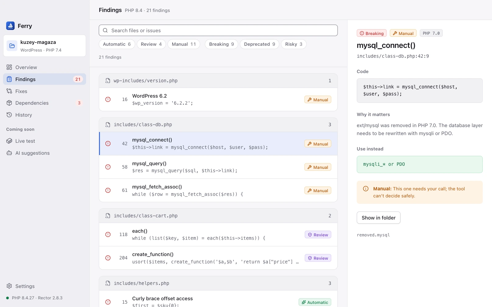
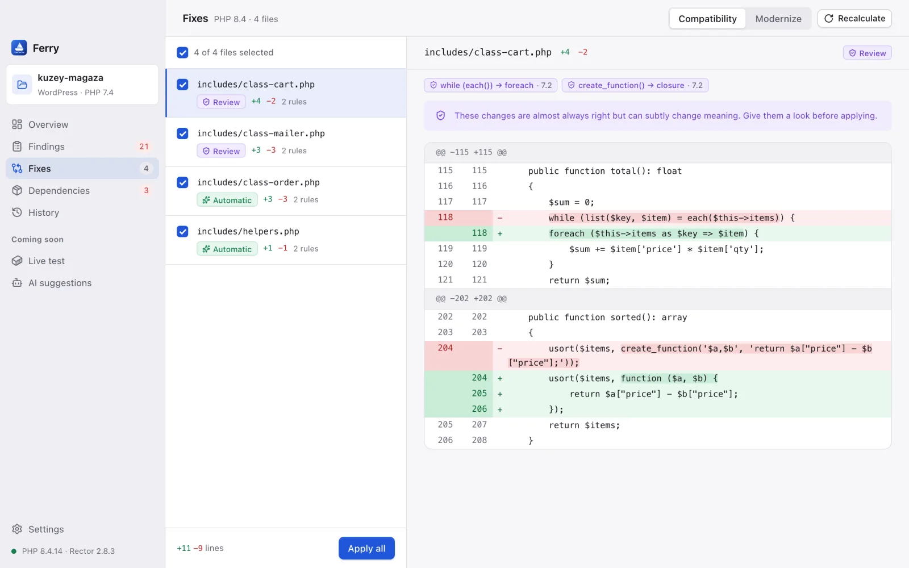
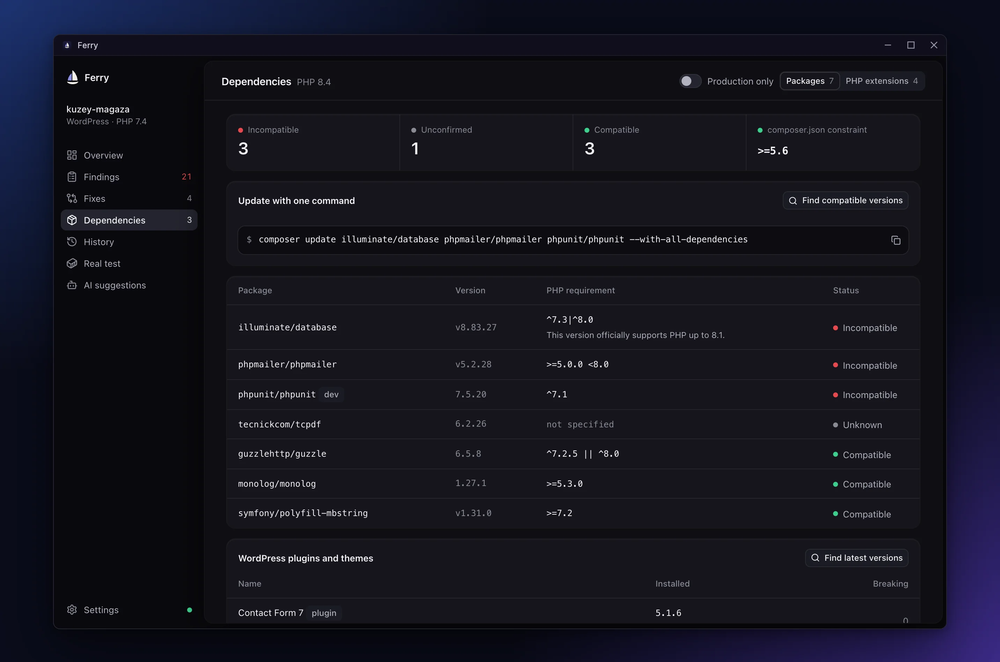
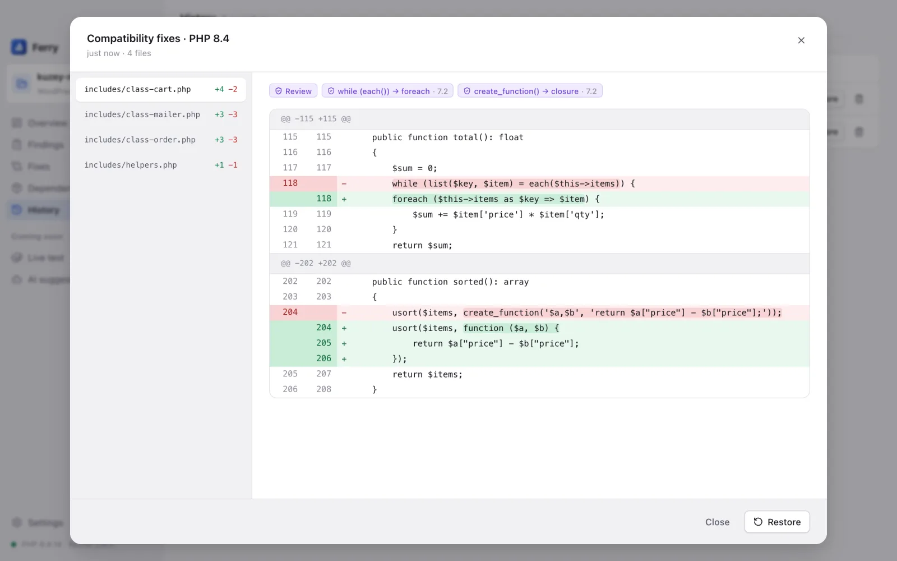

# Ferry

**Find what breaks when your PHP project moves to a new version, and fix it safely.**

A desktop app for macOS, Windows and Linux that scans your PHP code, shows what will break on the version you are moving to, and applies Rector's fixes only after you approve them, with a backup before every change. No account, no cloud, no telemetry.

[](../../releases/latest)

    [](LICENSE)

[Features](#features) · [Install](#install) · [Privacy](#privacy) · [How it works](#how-it-works) · [Build from source](#build-from-source) · [Türkçe](README.tr.md)


- **See the problems before your users do.** Code that was removed or changed between PHP 7.0 and 8.5 is listed with its file, line, and the reason it matters. [docs/COVERAGE.md](docs/COVERAGE.md) shows what a scan can and can't find.
- **Nothing changes without your approval.** Rector runs in dry-run mode only. You review each change line by line and apply only the files you pick.
- **Undo any change in one click.** A backup is taken before every apply, so you can go back without Git.

## What sets it apart

- **Know how much work is ahead.** A score from 0 to 100 and the split into automatic, review, and manual fixes tell you at a glance how big the migration is.
- **Know which fixes you can trust.** Every finding and every change is labeled **Automatic** (a rule-based change designed to keep behavior the same), **Review** (usually right, but worth a look), or **Manual** (it needs your decision).
- **Fix only what is needed, or modernize too.** **Compatibility** mode makes only the changes the code needs to run on the new version. **Modernize** also adopts newer syntax such as `match`, constructor promotion, and `str_contains`.
- **Find the packages that hold you back.** Ferry reads `composer.lock` and shows which packages do not support the target version, before you start changing code.
- **Disk content matches the preview exactly.** Ferry applies the changes itself, exactly as you saw them, and refuses to touch a file that changed after the preview.
- **No setup to start scanning.** The scan is built into Ferry and needs no PHP. PHP and Composer are needed only for automatic fixes, and Ferry installs Rector for you.

## Features

### A readiness score for your target version

Pick the version you are moving to (PHP 8.2 to 8.5) and Ferry scans every PHP file in seconds. The **Overview** shows:

- the project's platform (one of the ten listed under [Supported projects](#supported-projects), or plain PHP), its number of PHP files, and its current PHP version from `composer.json`
- a readiness score from 0 to 100, and how many issues fall into each fix type; the score is an estimate of the work left, not a guarantee the app runs
- next to the score, what still stands in the way: issues that block the upgrade, files the scan couldn't cover, dependencies that block it or couldn't be confirmed, and whether lint or tests ran on the target. The headline only says the project is ready when all of these are clear
- how many findings are **Breaking** (the code won't run), **Deprecated** (it warns now and will be removed later), or **Risky** (it may behave differently at runtime)
- the most common issues and the next steps to take

Every number is a shortcut: click **Breaking**, **Manual** or one of the most common issues, and **Findings** opens filtered to exactly those. Switching the target version rescans right away; if you've already calculated fixes, Ferry asks before discarding them.

Framework code you don't maintain is skipped automatically: `wp-admin` and `wp-includes` in WordPress, `storage` and `bootstrap/cache` in Laravel, `var` in Symfony, Drupal core, and `vendor` and `node_modules` everywhere. The overview names the skipped folders.

**Compare targets** scans the project for PHP 8.2, 8.3, 8.4 and 8.5 at once and puts the score, breaking, deprecated and manual findings, and blocking packages side by side, so you can see whether going straight to 8.5 costs much more than stopping at 8.3. **Switch to this target** picks one.

After the second scan, **Since the last scan** shows how many findings were resolved and how many are new, with the readiness score of every scan for that target as a trend line. Ferry keeps the last 30 scans per target in its own data folder, never in the project.

**Export report** saves the results as a Markdown file you can attach to a ticket or share with your team.

### Every finding, explained

The **Findings** page lists every issue grouped by file, with the line, the code, and its fix type. Search files and issues, filter by fix type or severity, and see how many findings match. A rule picked on the overview shows up as a filter you can remove, and **Clear filters** resets everything. Filters stay put when you switch pages.



Select a finding to see:

- the code that triggers it
- why it matters and since which PHP version
- what to use instead
- whether it can be fixed automatically

**Show in folder** opens the file's location, and **Open in editor** opens the file at that line in the editor picked in **Settings** (Visual Studio Code, Cursor, PhpStorm, Sublime Text, Zed, or the system default). Use the arrow keys to move through the list.

**Ignore** takes a finding out of the list and the score once you've decided it doesn't apply, for example code that only runs on the old server. Ferry asks for a reason and saves it to `.ferry/ignore.json` in the project, so the decision travels with the code when you commit that file. The match uses the rule, the file and the code, so an ignored finding stays ignored when lines above it move. **Ignored** on the Findings page lists them with their reasons, and **Show again** brings one back.

**Import log** adds what really happened when the code ran. Point it at a PHP error log (`php_errors.log`, Apache's `error_log`) or the output of `phpunit --display-deprecations`, ideally from a run on the target version. Each deprecation, warning or fatal error is matched to the project file and line: a finding on that line gets a **Runtime ×N** badge when the message fits it (a fatal error only confirms a **Breaking** finding, and a message that names a different function doesn't count), and every other message is added as a finding of its own. A message only counts as part of the project when its path clearly belongs to it: a file in a subfolder, two or more files under the same folder, or a folder with the project's name. Messages from other projects count as outside. A shared log can still match by accident, so you can enter the **project root on the server**; then only paths under that root count. **Seen at runtime** filters the list to them. The log stays in memory until you remove it or close the project. `ferry-cli --runtime-log <file>` does the same in CI, with `--runtime-root <path>` for the root.

When the target PHP version is installed on this computer (Homebrew, Herd, MAMP, Laragon, phpenv or a `php8.x` binary), the Findings page also offers **Lint with PHP 8.x**, which runs `php -l` on every file with that PHP, and **Run tests on PHP 8.x**, which runs `vendor/bin/phpunit` after asking first. Their warnings are merged the same way as an imported log, and the result stays above the list: how many files were linted or couldn't be checked, whether the tests passed, failed (with the exit code) or were stopped at the time limit, and the command's output.

You can also ignore a finding in the code itself: a `// ferry-ignore removed.each only runs on the PHP 5 server` comment on the same line or the line above ignores that rule there, `removed.*` covers a group, and a bare `// ferry-ignore` covers every rule on the line. Only real comments count, including `<!-- ferry-ignore -->` in template HTML; the same words inside a string don't. A finding ignored this way is shown again by removing the comment, so its detail panel has no **Show again** button. When an entry in `.ferry/ignore.json` no longer matches any code, because it changed or was deleted, the Findings page says so and offers to remove it.

Ferry has its own PHP lexer and rule set, so it reads code the way PHP does: method calls such as `$db->each()`, functions in your own namespace, and text inside strings and comments are not mistaken for removed functions. Its rules cover:

- removed extensions and functions, such as `mysql_*`, `ereg*`, `each()`, `create_function()`, and `money_format()`
- every built-in function, class, method and constant that PHP 7.0 to 8.5 removed or deprecated, from a table generated with PHP's own reflection data (for example the DOM classes removed in 8.0, `SplFixedArray::rewind()`, old-style `parent::SoapClient()` constructor calls and the `MYSQLI_*` constants removed in 8.4)
- syntax that no longer parses or compiles, such as `$str{0}`, `(real)` and `(unset)` casts, `$obj = &new Foo`, `$args = &func_get_args()`, `unset($this)`, writes to the whole `$GLOBALS` array, reserved names such as `Object` used as import aliases, `break` outside a loop, and PHP 7 `#[` comments, which PHP 8 reads as attributes
- deprecations, such as `"${var}"` interpolation, implicit nullable parameters, `utf8_encode()`, `FILTER_SANITIZE_STRING`, and `E_STRICT`
- parameter and call patterns, such as an optional parameter before a required one, a literal `null` passed to built-in string functions, and `"self::method"` style callables
- methods that override a built-in class or interface method with a signature PHP 8 rejects, such as Drupal 7's `query($query, array $args = array(), $options = array())` on a `PDO` subclass, which stops the class from loading
- methods that override a parent class, trait or interface method in the project with a signature PHP 8 rejects, such as phpBB 3.2's `create_insert_array($user, $pre_create_data)` making a parameter required that the parent declares optional, which was only a warning in PHP 7
- methods that override a built-in class or interface without a return type, such as `PDO::query()` or `Iterator::current()`, which need `#[\ReturnTypeWillChange]` from PHP 8.1
- code that stops working on a newer version, such as a function or class PHP added later (`str_contains()`, `JsonException`) declared without a `function_exists()` check, `Class::method()` on a non-static method, calls with too few arguments to your functions, methods and constructors, built-in functions called with the wrong number of arguments (`mktime()`, `crypt($pw)`), error handlers that require a fifth `$errcontext` parameter, exception handlers typed `Exception`, `parent::` in a class without a parent, the `preg_replace()` `/e` modifier, and `is_resource()` on curl, GD or pgsql handles that are now objects
- `error_reporting() == 0` checks for `@`, which no longer match in PHP 8
- code worth a manual check, such as `eval()`, `extract()`, and variable variables

Ferry also reads the files around the code that decide which PHP actually runs:

- `.htaccess`: `php_value` and `php_flag` lines outside `<IfModule mod_php.c>`, which give a 500 error on PHP-FPM, and `<IfModule mod_php5.c>` or `mod_php7.c` blocks that PHP 8 no longer matches
- `.user.ini`, `php.ini` and `.htaccess` settings that PHP removed or deprecated, such as `register_globals` (PHP won't start with it on), `track_errors`, `allow_url_include` and `session.trans_sid_hosts`
- `composer.json` with `platform-check` turned off, and a `composer.lock` written by Composer 1
- PHP versions pinned below your target in `Dockerfile`, Docker Compose, GitHub Actions, GitLab CI, Travis, Bitbucket Pipelines, `.tool-versions`, `.php-version`, and `config.platform.php` in `composer.json`

### Review every change before it is applied

The **Fixes** page runs Rector on your project in dry-run mode. No files change. Each changed file shows its diff line by line, the rules that produced it, and how far you can trust it.



- **Compatibility** makes only the changes needed to run on the new version. It is the best place to start.
- **Modernize** also adopts newer syntax for the target version.
- Pick the files you want and press **Apply**. Automatic files start selected; files marked **Review** start unselected and carry a note to check them first. Until you open one, it is labeled **Not viewed**, and the confirmation says how many automatic and review files you are applying and whether you skipped any diffs.
- **Narrow the selection** picks only the automatic fixes, or only the files a given Rector rule changed, so you can apply and commit one kind of change at a time. Selection works per file: other changes in those files are applied too.
- In a Git project, the confirmation lists selected files that already have uncommitted changes and offers a ready-to-copy commit message that names the rules being applied.
- After applying, Ferry checks the changed files with `php -l` and warns you if a change left one that no longer parses, so you can roll it back from **History** right away.

Ferry handles cases Rector cannot on its own. For example, a file that uses `$str{0}` makes Rector skip the whole file. Ferry rewrites those offsets to `$str[0]` first, and does the same for `= &new`, `= &func_get_args()` and `default;`, so the rest of the file is still fixed.

### Dependencies that block the upgrade

The **Dependencies** page checks every locked package against the target version, using the PHP requirement each package declares in `composer.lock`. The project's own PHP constraint in `composer.json` is checked too. A `conflict` entry for `php`, in `composer.json` or in a locked package, is taken into account as well.

A declared requirement like `^8.0` doesn't always mean the package works on the newest PHP. For Laravel (`laravel/framework`, `illuminate/*`), Drupal core, and Symfony's core packages, Ferry also uses the framework's published support range and explains the difference under the requirement.



Each package is marked **Compatible**, **Incompatible**, or **Unknown** (when the package declares no PHP requirement, or one Ferry can't read), with incompatible packages listed first. When nothing blocks the upgrade but some packages are unknown, the page says so instead of calling everything compatible. Development packages are labeled, and **Production only** hides them. The warning above the list gives a ready-to-copy `composer update` command naming exactly the packages that block the upgrade.

**Find compatible versions** asks Packagist which release to move each blocking package to: the newest release of the first major version whose PHP requirement, and the framework's own support range where Ferry knows it, allows the target. It's the only feature that goes online, and only when you click it.

In a WordPress project, **WordPress plugins and themes** lists every plugin and theme with its installed version, its `Requires PHP` header and the breaking issues found in its own code. **Find latest versions** asks api.wordpress.org for the current release of each and marks plugins that were closed there.

**Server** checks the machine you're moving to. **Create probe file** saves a one-file `ferry-probe.php` that answers only with its random token. Upload it to the server's web folder, open `https://your-site/ferry-probe.php?token=…`, and paste the JSON it prints. Ferry compares it with the target: the server's PHP version (and whether it's a vulnerable release), the server API (PHP-FPM, where `php_value` in `.htaccess` breaks), extensions the code uses that the server lacks, `disable_functions` and `memory_limit`. Delete the file from the server afterwards.

**PHP extensions** lists every extension the code uses, such as `mysqli`, `gd` or `intl`, with how often and where it's first used. It shows whether `composer.json` declares it as `ext-*` and whether the PHP on this computer has it. Extensions that left PHP, such as `imap` in 8.4, are marked. Ready-to-paste `ext-*` lines are offered for the ones `composer.json` doesn't declare, so Composer checks the new server for them.

### Undo anything from History

Before every apply, Ferry backs up the files it is about to change. The **History** page lists every apply with its time and number of files.



- **Review** shows exactly what each apply changed, file by file, with the rules behind each change.
- **Restore** puts every file back as it was before that apply. If you edited any of them since, Ferry lists them first, backs up their current content as a new History entry, and refuses to overwrite a file that changes after you confirmed.
- **Backups to keep** in **Settings** limits how many backups each project keeps (10, 30 or 100). It is unlimited by default.
- If an apply fails partway, Ferry rolls the files back on its own. If even that fails, the backup stays in History so you can restore it yourself.

### Made for your desktop

- **Turkish and English** interface. The language also applies to exported reports.
- **Light and dark** themes, or follow the system.
- **Drag and drop** a project folder onto the window, or reopen a recent project from the start screen.
- **Resizable panels:** drag the line between a list and its details on **Findings** and **Fixes**, or focus it and use the arrow keys. The size is remembered; double-click the line to reset it.
- **Keyboard shortcuts:** **⌘O** opens a project, **⌘1** to **⌘5** switch between pages, **⌘,** opens **Settings**, and **⌘+** / **⌘−** zoom the interface. On Windows and Linux, use **Ctrl** instead of **⌘**.
- **Accessible:** everything works from the keyboard and focus is always visible. Every screen and dialog is checked with axe in the tests, and the native e2e measures WCAG 2.1 AA text contrast in the real app window in both themes. Screen reader behavior isn't tested automatically. At high zoom levels the layout stacks its panes and narrows the sidebar to icons.

### Command line for CI

`ferry-cli` runs the same scan without the window, so a pipeline can stop a merge that adds code the target version can't run. It reads `.ferry/ignore.json`, so findings ignored in the app stay ignored in CI.

```bash
cargo build --release -p ferry-cli
target/release/ferry-cli scan . --target 8.4 --format github
```

- `--format text|json|sarif|github|junit|checkstyle|csv`: plain text, JSON with the summary and ignored findings, SARIF 2.1.0 for GitHub code scanning and other viewers, GitHub Actions annotations on the changed lines, JUnit XML for Jenkins and GitLab test reports, Checkstyle XML, or CSV for spreadsheets. `--blame` adds the `git blame` author of each line to the CSV, so the work can be split across a team.
- `--fail-on breaking|deprecated|any|none`: the lowest severity that makes the command exit with code 1 (default `breaking`). Errors such as a missing folder exit with code 2.
- `--allow-incomplete`: by default a scan that couldn't read some files (for example one over 2 MB) exits with code 3, lists them on stderr and reports them in every format (`complete`, `filesFound` and `errors` in JSON, `executionSuccessful` in SARIF). This flag lets such a scan pass; the action has a matching `allow-incomplete` input.
- `--output <file>` writes the report to a file, and `--lang tr` switches the messages to Turkish.
- `--write-baseline <file>` saves today's findings, and `--baseline <file>` compares with them: only findings that aren't in the baseline count toward `--fail-on`, and `--fail-on new` fails on any of them. This lets a project with hundreds of old findings stop new ones from coming in.

With Docker running, the **Docker comparison** screen or `ferry-cli compare <project> --target 8.5` lints the project and runs its PHPUnit tests in `php:X.Y-cli` containers on the current and target versions, and lists what's new on the target. The containers work on copies and have no network; only `composer install` does, without the project's scripts or plugins. Extensions the project uses, such as `mysqli` or `gd`, are built into a local `ferry-php` image first with [docker-php-extension-installer](https://github.com/mlocati/docker-php-extension-installer), pinned by checksum, and that image is reused. Project code doesn't run during the build. `--no-extensions` or the checkbox in the app skips it, and anything still missing is listed. Pages are also served inside the containers with `php -S` and compared by status, redirect, PHP errors and content, starting at `/` and following links with GET requests only. `--page <path>` adds a starting page, and `--no-pages` or the checkbox in the app skips this. Each version can also get its own database: `--db-dump <file>` imports a `.sql` or `.sql.gz` file, `--db-live` copies a SQLite file or a MySQL, MariaDB or PostgreSQL database on this computer using the project's `.env` or `wp-config.php`, and `--db-seed` runs Laravel or Symfony migrations and seeders once and gives both versions the same rows. The app offers the same choices. Data stays in temporary folders and containers, the copy's settings point at its own database, nothing is written to the live database, and tables that differ after the requests are listed. Without a database, pages that need one are marked as not comparable. These images take 600–750 MB each. Remove them when a comparison ends with `--clean-images` or the checkbox beside it, or at any time in Settings or with `ferry-cli clean-images`. The official `php` images stay.

The repository is also a GitHub Action that builds `ferry-cli` and annotates pull requests:

```yaml
- uses: efekoca/ferry@main
  with:
    target: "8.4"
    baseline: .ferry/baseline.json
    fail-on: new
```

Set `sarif: "true"` to also write `ferry.sarif` for `github/codeql-action/upload-sarif`.

## Supported projects

| Project type | Detected by | Skipped automatically |
|---|---|---|
| **WordPress** | `wp-config.php`, `wp-config-sample.php`, or a `wp-includes` folder | `wp-admin`, `wp-includes` (core); your themes and plugins are scanned |
| **Laravel** | the `artisan` file, or `laravel/framework` in `composer.json` | `storage`, `bootstrap/cache` |
| **Symfony** | `symfony/framework-bundle` in `composer.json`, or `bin/console` | `var` |
| **Drupal** | `drupal/core` in `composer.json`, `core/lib/Drupal.php` (also under `web/`, `docroot/`, `html/`, or `public/`), or Drupal 7's `includes/bootstrap.inc` | Drupal core, `sites/default/files` |
| **Magento** | `app/Mage.php` (Magento 1), `bin/magento`, or a `magento/product-*` package in `composer.json` | `generated`, `var`, `pub/static`, `setup`, `dev`; in Magento 1, `app/code/core` and `lib` |
| **PrestaShop** | `config/settings.inc.php`, `app/AppKernel.php`, or `classes/PrestaShopAutoload.php` | core folders such as `classes`, `controllers`, `src`, `app`; `modules`, `override` and `themes` are scanned |
| **Joomla** | `libraries/src/Version.php` with an `administrator` folder, or Joomla 3's `libraries/cms/version/version.php` | `cache`, `tmp`, `administrator/cache`, `libraries/vendor`, `media` |
| **Moodle** | `version.php` (or `public/version.php` from 5.1) with `lib/moodlelib.php` | `vendor` folders |
| **MediaWiki** | `MW_VERSION` in `includes/Defines.php`, or `$wgVersion` in `includes/DefaultSettings.php` | core folders such as `includes`, `languages`, `maintenance`, `resources`; `extensions` and `skins` are scanned |
| **phpBB** | `PHPBB_VERSION` in `includes/constants.php` (also under `phpBB/`) | core folders such as `phpbb`, `includes`, `cache`, `install`; `ext` and `styles` are scanned |
| **Plain PHP** | any folder with PHP files | — |

For WordPress, Laravel, Drupal, Magento, PrestaShop, Joomla, Moodle, MediaWiki, phpBB, and Symfony, Ferry also checks the platform itself:

- **WordPress:** the core version in `wp-includes/version.php` against the oldest WordPress release that supports your target PHP version (for example, PHP 8.4 needs WordPress 6.7).
- **Laravel:** the `laravel/framework` version in `composer.lock` against Laravel's supported PHP range, plus the `str_*` and `array_*` helpers and the `Input` facade that Laravel 6 removed. PHP 8 needs Laravel 6.20 or newer, so these break too unless `laravel/helpers` is installed.
- **Drupal:** the core version against Drupal's PHP requirements (for example, PHP 8.5 needs Drupal 11.3). Drupal 7 is checked too: PHP 8.2 needs 7.94 and PHP 8.3 needs 7.103, and no Drupal 7 release runs on PHP 8.4.
- **Magento:** Magento 2's version in `composer.lock` against Adobe's system requirements (for example, PHP 8.4 needs 2.4.8). Magento 1 never supported PHP 8, so it's flagged unless the project uses the OpenMage LTS fork.
- **PrestaShop:** the core version against PrestaShop's requirements: 1.6 and 1.7 don't support PHP 8, 8.0–8.2 go up to PHP 8.1, and 9.x goes up to PHP 8.5.
- **Joomla:** the core version against the PHP versions the Joomla manual lists for each release: 3.x goes up to PHP 8.0, 4.0.5 adds 8.1, 4.3 adds 8.2, 5.0 supports 8.3, 5.3 adds 8.4 and 5.4 adds 8.5. Joomla only publishes recommended versions for 5.x and 6.x, so those are marked **Risky**.
- **Moodle:** `$release` in `version.php` against Moodle's PHP policy, down to the patch release (for example, PHP 8.2 needs 4.2.3 and PHP 8.4 needs 5.0).
- **MediaWiki:** the version against mediawiki.org's compatibility matrix (for example, PHP 8.4 needs 1.46). The matrix has gaps, so findings are marked **Risky**.
- **phpBB:** `PHPBB_VERSION` against the PHP range in each release's `INSTALL.html`: 3.3.6 adds PHP 8.0 and 8.1, 3.3.12 adds 8.2 and 8.3, and no stable release supports 8.4 yet.
- **Symfony:** Symfony doesn't publish a maximum PHP version, so a release whose maintenance ended before your target PHP version came out is marked **Risky**.

`vendor` and `node_modules` are always skipped. Files larger than 2 MB are skipped and listed in the scan results, so nothing is left out silently.

Target versions: **PHP 8.2, 8.3, 8.4, and 8.5**. The scan covers changes from PHP 7.0 onward, so projects on PHP 5.6 and 7.x are covered too.

PHP 8.1 can't be selected as a target. [CVE-2026-109618 and CVE-2026-109619](https://www.cisa.gov/news-events/alerts/2026/10/21/critical-vulnerabilities-php-require-immediate-patching), disclosed in October 2026 and exploited in the wild, allow unauthenticated remote code execution on PHP 5.4 through 8.5.11. 8.1 reached [end of life](https://www.php.net/eol.php) on 31 December 2025 and won't get the fix. Servers should run at least 8.2.35, 8.3.36, 8.4.27, or 8.5.12; **Settings** warns when the PHP on your computer is older than the fixed release for its branch.

## Install

Download the file for your system from the [latest release](../../releases/latest). Open a project folder and press **Start scan**. Ferry reads nothing until you choose a folder.

### macOS

macOS 11 or newer, on Apple silicon and Intel Macs.

1. Open `Ferry_x.y.z_universal.dmg` and drag **Ferry** to **Applications**.
2. Open Ferry from **Applications**.

> **Gatekeeper.** Ferry is not signed with an Apple Developer ID yet, so macOS may refuse to open it the first time. Open **System Settings → Privacy & Security** and choose **Open Anyway** next to the message about Ferry.

**Uninstall.** Drag the app to the Trash. Backups and settings stay in `~/Library/Application Support/io.github.efekoca.ferry` until you delete that folder.

### Windows

Windows 10 and 11.

1. Run `Ferry_x.y.z_x64-setup.exe`. The installer is **per-user** and needs no administrator rights.
2. Windows 11 already includes WebView2. On Windows 10, the installer adds it if it is missing.

> **SmartScreen.** The installer is not code-signed, so Windows may show "Unknown publisher". Choose **More info → Run anyway**.

**Uninstall.** Use Windows Settings → Apps. Backups and settings stay in `%APPDATA%\io.github.efekoca.ferry` until you delete that folder.

### Linux

Any recent 64-bit distribution with WebKitGTK 4.1, such as Ubuntu 22.04, Debian 12 or Fedora 39 and newer.

- **Debian and Ubuntu:** install `Ferry_x.y.z_amd64.deb` with `sudo apt install ./Ferry_x.y.z_amd64.deb`, which also pulls in WebKitGTK.
- **Other distributions:** make `Ferry_x.y.z_amd64.AppImage` executable (`chmod +x`) and run it. It needs WebKitGTK 4.1 and FUSE 2 from your package manager.

**Uninstall.** Remove the package (`sudo apt remove ferry`) or delete the AppImage. Backups and settings stay in `~/.local/share/io.github.efekoca.ferry` until you delete that folder.

### Automatic fixes

The scan and the dependency check work right away. Automatic fixes also need:

- **PHP 7.4 or newer** on the computer (it doesn't have to be the version your project uses). Ferry finds the PHP on your `PATH`, and also looks in the usual places for Homebrew, Herd, and MAMP on macOS, XAMPP, Laragon, and Scoop on Windows, and Snap, Linuxbrew, phpenv, asdf, and phpbrew on Linux. You can also choose the executable under **Settings**.
- **Composer.** Ferry uses it once to install Rector into its own folder; your project's `composer.json` is never touched.

When something is missing, the **Fixes** page says what and offers **Install Rector**.

## Privacy

> **Your code never leaves your computer.** Ferry reads and changes files only in the folder you open, and has no telemetry.

- **Read:** the PHP files in the project folder you choose, plus `composer.json`, `composer.lock`, and the files that decide which PHP runs: `.htaccess`, `.user.ini`, `php.ini`, Dockerfiles, Docker Compose and CI configuration.
- **Written:** only the files you apply changes to, and `.ferry/ignore.json` when you ignore a finding. Every other file stays untouched.
- **Stored:** backups of the files before each apply (all of them, or only the newest if you set a limit), a record of what was applied, the last 30 scan summaries per target, Rector's cache, and your settings, in the app's data folder: `~/Library/Application Support/io.github.efekoca.ferry` on macOS, `%APPDATA%\io.github.efekoca.ferry` on Windows, and `~/.local/share/io.github.efekoca.ferry` on Linux.
- **Project code:** scanning never runs your code. Calculating fixes runs Rector in the project folder, and Rector loads the project's `vendor/autoload.php`, so files listed under Composer's `autoload.files` are executed. Only calculate fixes for projects you trust.
- **Network:** Ferry makes no network requests on its own. When you choose **Install Rector**, Composer downloads Rector from Packagist. When you choose **Find compatible versions**, Ferry sends the names and versions of the blocking packages to `repo.packagist.org`, and **Find latest versions** sends WordPress plugin and theme names to `api.wordpress.org`.

## How it works

Everything runs on your computer:

1. Ferry detects the project type and the current PHP version, and skips folders you don't maintain.
2. Its built-in scanner tokenizes every PHP file and checks it against the rules for each version between your current one and the target.
3. For fixes, Rector runs in dry-run mode on your project, and you can stop it at any time. Ferry turns its proposed diffs into a preview and keeps a fingerprint of each file.
4. When you apply, Ferry first backs up the selected files, then checks that none of them changed since the preview, and writes each one in a single step. A file that changed in the meantime is refused. Files reached through a symbolic link, or that have other names (hard links), are never written, and read-only files stay read-only. If any write fails, every file already written is put back. Fixes only ever touch files the scan covers, so hidden folders such as `.git` or `.ddev` are never changed.
5. Restoring first checks every backup copy, then puts the files back; if one write fails, the rest are returned to how they were. Files you edited after the apply are listed for confirmation, and their current content is backed up first. **Review** in History shows the changes that were applied.

## Known limitations

- **Coverage:** [docs/COVERAGE.md](docs/COVERAGE.md) goes through every incompatible change, deprecation and removal in php-src's `UPGRADING` files from 7.0 to 8.5 and says whether Ferry reports it, only reports some forms of it, misses it, or can't find it without running the code. Of 720 items, 468 are covered, 3 partly covered, 184 only show up at runtime and 62 don't affect application code. The other 3 can be found statically but are left out on purpose, because nearly every match would be a false alarm.
- **Static analysis:** the scan reads code without running it, so behavior that depends on runtime values (for example, functions called by name from a string) can't always be found. Such cases are marked **Risky** where possible. Code that only runs on older versions, such as the body of `if (PHP_VERSION_ID < 80100)`, `version_compare(PHP_VERSION, '8.0', '<')`, the unreachable side of a version ternary or `&&`, code after `if (PHP_VERSION_ID >= 80000) { return …; }`, or `if (function_exists('mysql_connect'))`, is skipped. Syntax that PHP rejects or deprecates while compiling, such as `$str{0}` or `(double)`, is still reported there, because PHP compiles the whole file even if that branch never runs. A built-in method called on a variable (for example `$s->attach()`) is only reported when the code shows the variable's class: `new SplObjectStorage`, a `SplObjectStorage $s` type or an `instanceof` check. Functions you define yourself with a removed name, for example an `each()` polyfill or a `mysql_*` shim loaded through Composer, are not reported, unless they are only defined in a branch that doesn't run on the target, such as `if (PHP_VERSION_ID < 80000)`. The opposite case is: a function or class that PHP added later, such as `str_contains()` or `JsonException`, declared without a `function_exists()` or `class_exists()` check stops the file from loading. Files that are only included behind a version check are skipped.
- **Behavior changes:** some changes only show up when the code runs, so no static tool can find them. Test these by running your app on the new version:
  - `0 == "foo"` is now `false`, which also affects `in_array()`, `array_search()` and `switch`.
  - Arithmetic on non-numeric strings throws a `TypeError`.
  - Many warnings became exceptions, for example `count()` on a non-countable value.
  - Resources such as curl, GD and XML handles are now objects, so `is_resource()` checks fail. Ferry reports the check when the same file assigns the handle, for example `$ch = curl_init()` followed by `is_resource($ch)`, but not when the handle comes from somewhere else.
  - PDO MySQL and SQLite return real integers and floats, so `=== "1"` comparisons fail.
  - Passing `null` through a variable to a built-in function is deprecated. Ferry reports a literal `null`, but can't see what a variable holds.
  - Dynamic properties are deprecated. Ferry follows parent classes and traits inside your project, but skips classes that extend something it can't see, such as a framework class in `vendor/`, because that parent could declare the property.
  - Required extensions such as imap or mcrypt may be missing on the new server.
- **Method calls:** Ferry can't know an object's class without running the code, so a method call on a variable such as `$db->ping()` is only flagged when the code shows the variable's class (`new mysqli`, a `mysqli $db` type or an `instanceof` check). Calls on properties, such as `$this->db->ping()`, are flagged when the file mentions the class. Static calls, `parent::` calls and class constants like `PDO::MYSQL_ATTR_INIT_COMMAND` are always checked.
- **Encodings:** automatic fixes skip files that are not UTF-8 (for example, Windows-1254 or Latin-1), so they are never corrupted. Convert them to UTF-8 to have them fixed.
- **Manual fixes:** findings such as `mysql_*` need code to be rewritten, and Ferry shows what to use instead but doesn't rewrite them for you.
- **Restore:** it puts back the files as they were before the apply, so edits you made to them afterwards are replaced. Ferry lists those files, asks before restoring, and keeps their current content in History.

## Build from source

Requirements: Rust (stable), Node 22, and pnpm, plus PHP 7.4+ and Composer for the Rector tests. On Windows you also need Visual Studio Build Tools (C++), on macOS the Xcode Command Line Tools, and on Linux WebKitGTK 4.1 and its build dependencies (on Ubuntu: `libwebkit2gtk-4.1-dev libgtk-3-dev librsvg2-dev libayatana-appindicator3-dev`).

```bash
pnpm install
pnpm tauri dev            # desktop app
pnpm dev                  # interface only, in a browser with sample data
pnpm typecheck && pnpm test
cargo test --workspace
pnpm tauri build          # installers → target/release/bundle/
```

To run the tests against real Rector, point `FERRY_TEST_TOOLS` to a folder where Rector is installed: `FERRY_TEST_TOOLS=/path/to/tools cargo test --workspace`.

`scripts/fetch-corpus.sh` downloads old releases of WordPress, Drupal, CodeIgniter, phpBB, Joomla, Magento, PrestaShop, Laravel, Symfony, CakePHP, Yii, MediaWiki and Moodle, and `CORPUS=<folder> CORPUS_PHP=$(which php) cargo test -p ferry-core --test corpus -- --ignored --nocapture` compares the scanner with what that PHP itself reports for them.

`crates/ferry-core/src/symbols.rs` is generated from PHP itself: `scripts/php-symbols/dump.sh <folder>` builds a Docker image per PHP version from 7.0 to 8.5 with the same extensions and dumps every built-in function, class, method, constant and ini setting with reflection, and `node scripts/php-symbols/generate.mjs <folder> > crates/ferry-core/src/symbols.rs` lists what each version removed or deprecated. `scripts/php-symbols/verify.php` checks the table against a PHP, and the `symbols` test fails if the scanner misses any of them. When a new PHP version comes out, add it to `dump.sh` and regenerate.

`scripts/runtime-benchmark.sh <project> <test-dir> [target]` runs a project's PHPUnit tests in Docker on the target PHP and merges the deprecations they report with the static scan; the latest results are in [docs/ROADMAP.md](docs/ROADMAP.md).

`pnpm e2e:native` drives a debug build of the real app through the demo projects and edge cases such as a Unicode path, a symlink loop and an empty project, checks text contrast in both themes, and reports each scenario.

The screenshots in this README come from `node scripts/readme-shots.mjs` while `pnpm dev` is running: it drives the sample-data interface in headless Chrome, frames each page and writes PNG files to `assets/readme/`, which are then converted to WebP with `cwebp`.

**Demo projects.** The `demo/` folder holds three sample projects: a plain PHP shop that triggers every rule, a WordPress blog, and a Laravel API that is nearly ready. `pnpm demo` copies them fresh into `.demo/`, so you can apply changes without touching the originals. See [demo/README.md](demo/README.md).

| Path | Contents |
|---|---|
| `crates/ferry-core` | the engine: lexer, rules and analyzer, Rector integration, diffs, backups, and Composer checks |
| `crates/ferry-cli` | command-line scanner for CI, with text, JSON, SARIF, GitHub annotation, JUnit, Checkstyle and CSV output |
| `src-tauri` | desktop shell: commands, window, and platform settings |
| `src` | React and TypeScript interface (design system in [docs/DESIGN.md](docs/DESIGN.md)) |
| `demo` | sample projects for trying the app and for the tests |

CI checks formatting and runs the interface and engine tests (including real Rector) on Linux and Windows for every pull request and push to `main`, drives the real app with the native e2e on both, and builds the macOS, Windows and Linux packages for `v*` tags.

Bug reports and pull requests are welcome.

## License

[MIT](LICENSE)
