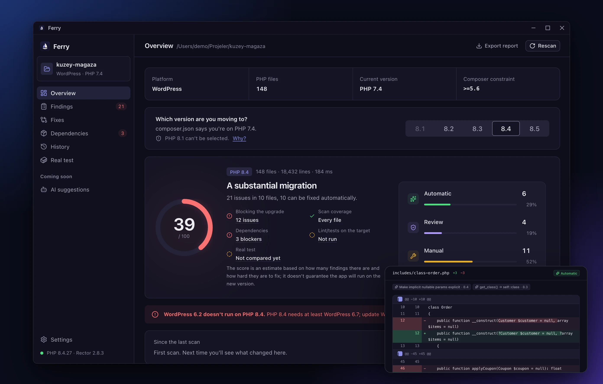

# Ferry

**Find what breaks when your PHP project moves to a new version, and fix it safely.**

A desktop app for macOS, Windows and Linux that scans your PHP code, shows what will break on the version you are moving to, and applies Rector's fixes only after you approve them, with a backup before every change. No account, no cloud, no telemetry.

[](../../releases/latest)

    [](LICENSE)

[Features](#features) · [Install](#install) · [Privacy](#privacy) · [How it works](#how-it-works) · [Build from source](#build-from-source) · [Türkçe](README.tr.md)



- **See the problems before your users do.** Every use of code that was removed or changed between PHP 7.0 and 8.5 is listed with its file, line, and the reason it matters.
- **Nothing changes without your approval.** Rector runs in dry-run mode only. You review each change line by line and apply only the files you pick.
- **Undo any change in one click.** A backup is taken before every apply, so you can go back without Git.

## What sets it apart

- **Know how much work is ahead.** A score from 0 to 100 and the split into automatic, review, and manual fixes tell you at a glance how big the migration is.
- **Know which fixes you can trust.** Every finding and every change is labeled **Automatic** (a rule-based change that keeps behavior identical), **Review** (usually right, but worth a look), or **Manual** (it needs your decision).
- **Fix only what is needed, or modernize too.** **Compatibility** mode makes only the changes the code needs to run on the new version. **Modernize** also adopts newer syntax such as `match`, constructor promotion, and `str_contains`.
- **Find the packages that hold you back.** Ferry reads `composer.lock` and shows which packages do not support the target version, before you start changing code.
- **Disk content matches the preview exactly.** Ferry applies the changes itself, exactly as you saw them, and refuses to touch a file that changed after the preview.
- **No setup to start scanning.** The scan is built into Ferry and needs no PHP. PHP and Composer are needed only for automatic fixes, and Ferry installs Rector for you.

## Features

### A readiness score for your target version

Pick the version you are moving to (PHP 8.2 to 8.5) and Ferry scans every PHP file in seconds. The **Overview** shows:

- the project's platform (WordPress, Laravel, Symfony, Drupal, or plain PHP), its number of PHP files, and its current PHP version from `composer.json`
- a readiness score from 0 to 100, and how many issues fall into each fix type
- how many findings are **Breaking** (the code won't run), **Deprecated** (it warns now and will be removed later), or **Risky** (it may behave differently at runtime)
- the most common issues and the next steps to take

Every number is a shortcut: click **Breaking**, **Manual** or one of the most common issues, and **Findings** opens filtered to exactly those. Switching the target version rescans right away; if you've already calculated fixes, Ferry asks before discarding them.

Framework code you don't maintain is skipped automatically: `wp-admin` and `wp-includes` in WordPress, `storage` and `bootstrap/cache` in Laravel, `var` in Symfony, Drupal core, and `vendor` and `node_modules` everywhere. The overview names the skipped folders.

**Export report** saves the results as a Markdown file you can attach to a ticket or share with your team.

### Every finding, explained

The **Findings** page lists every issue grouped by file, with the line, the code, and its fix type. Search files and issues, filter by fix type or severity, and see how many findings match. A rule picked on the overview shows up as a filter you can remove, and **Clear filters** resets everything. Filters stay put when you switch pages.


Select a finding to see:

- the code that triggers it
- why it matters and since which PHP version
- what to use instead
- whether it can be fixed automatically

**Show in folder** opens the file's location. Use the arrow keys to move through the list.

Ferry has its own PHP lexer and rule set, so it reads code the way PHP does: method calls such as `$db->each()`, functions in your own namespace, and text inside strings and comments are not mistaken for removed functions. Its rules cover:

- removed extensions and functions, such as `mysql_*`, `ereg*`, `each()`, `create_function()`, and `money_format()`
- syntax that no longer parses or compiles, such as `$str{0}`, `(real)` and `(unset)` casts, `$obj = &new Foo`, `unset($this)`, `break` outside a loop, and PHP 7 `#[` comments, which PHP 8 reads as attributes
- deprecations, such as `"${var}"` interpolation, implicit nullable parameters, `utf8_encode()`, `FILTER_SANITIZE_STRING`, and `E_STRICT`
- parameter and call patterns, such as an optional parameter before a required one, a literal `null` passed to built-in string functions, and `"self::method"` style callables
- methods that override a built-in class or interface method with a signature PHP 8 rejects, such as Drupal 7's `query($query, array $args = array(), $options = array())` on a `PDO` subclass, which stops the class from loading
- methods that override a built-in class or interface without a return type, such as `PDO::query()` or `Iterator::current()`, which need `#[\ReturnTypeWillChange]` from PHP 8.1
- code worth a manual check, such as `eval()`, `extract()`, and variable variables

### Review every change before it is applied

The **Fixes** page runs Rector on your project in dry-run mode. No files change. Each changed file shows its diff line by line, the rules that produced it, and how far you can trust it.


- **Compatibility** makes only the changes needed to run on the new version. It is the best place to start.
- **Modernize** also adopts newer syntax for the target version.
- Pick the files you want and press **Apply**. Files marked **Review** carry a note to check them first.
- After applying, Ferry checks the changed files with `php -l` and warns you if a change left one that no longer parses, so you can roll it back from **History** right away.

Ferry handles cases Rector cannot on its own. For example, a file that uses `$str{0}` makes Rector skip the whole file. Ferry rewrites those offsets to `$str[0]` first, and does the same for `= &new` and `default;`, so the rest of the file is still fixed.

### Dependencies that block the upgrade

The **Dependencies** page checks every locked package against the target version, using the PHP requirement each package declares in `composer.lock`. The project's own PHP constraint in `composer.json` is checked too.

A declared requirement like `^8.0` doesn't always mean the package works on the newest PHP. For Laravel (`laravel/framework`, `illuminate/*`), Drupal core, and Symfony's core packages, Ferry also uses the framework's published support range and explains the difference under the requirement.


Each package is marked **Compatible**, **Incompatible**, or **Unknown** (when the package declares no PHP requirement), with incompatible packages listed first. Development packages are labeled, and **Production only** hides them. The warning above the list gives a ready-to-copy `composer update` command naming exactly the packages that block the upgrade.

### Undo anything from History

Before every apply, Ferry backs up the files it is about to change. The **History** page lists every apply with its time and number of files.


- **Review** shows exactly what each apply changed, file by file, with the rules behind each change.
- **Restore** puts every file back as it was before that apply. If you edited any of them since, Ferry lists them first, and it refuses to overwrite a file that changes after you confirmed.
- **Backups to keep** in **Settings** limits how many backups each project keeps (10, 30 or 100). It is unlimited by default.
- If an apply fails partway, Ferry rolls the files back on its own. If even that fails, the backup stays in History so you can restore it yourself.

### Made for your desktop

- **Turkish and English** interface. The language also applies to exported reports.
- **Light and dark** themes, or follow the system.
- **Drag and drop** a project folder onto the window, or reopen a recent project from the start screen.
- **Keyboard shortcuts:** **⌘O** opens a project, **⌘1** to **⌘5** switch between pages, **⌘,** opens **Settings**, and **⌘+** / **⌘−** zoom the interface. On Windows and Linux, use **Ctrl** instead of **⌘**.
- **Accessible:** everything works from the keyboard, focus is always visible, and the interface meets WCAG 2.1 AA contrast. At high zoom levels the layout stacks its panes and narrows the sidebar to icons.

## Supported projects

| Project type | Detected by | Skipped automatically |
|---|---|---|
| **WordPress** | `wp-config.php`, `wp-config-sample.php`, or a `wp-includes` folder | `wp-admin`, `wp-includes` (core); your themes and plugins are scanned |
| **Laravel** | the `artisan` file, or `laravel/framework` in `composer.json` | `storage`, `bootstrap/cache` |
| **Symfony** | `symfony/framework-bundle` in `composer.json`, or `bin/console` | `var` |
| **Drupal** | `drupal/core` in `composer.json`, or `core/lib/Drupal.php` (also under `web/`, `docroot/`, `html/`, or `public/`) | Drupal core, `sites/default/files` |
| **Plain PHP** | any folder with PHP files | — |

For WordPress, Laravel, Drupal, and Symfony, Ferry also checks the framework itself:

- **WordPress:** the core version in `wp-includes/version.php` against the oldest WordPress release that supports your target PHP version (for example, PHP 8.4 needs WordPress 6.7).
- **Laravel:** the `laravel/framework` version in `composer.lock` against Laravel's supported PHP range, plus the `str_*` and `array_*` helpers and the `Input` facade that Laravel 6 removed. PHP 8 needs Laravel 6.20 or newer, so these break too unless `laravel/helpers` is installed.
- **Drupal:** the core version against Drupal's PHP requirements (for example, PHP 8.5 needs Drupal 11.3).
- **Symfony:** Symfony doesn't publish a maximum PHP version, so a release whose maintenance ended before your target PHP version came out is marked **Risky**.

`vendor` and `node_modules` are always skipped. Files larger than 2 MB are skipped and listed in the scan results, so nothing is left out silently.

Target versions: **PHP 8.2, 8.3, 8.4, and 8.5**. The scan covers changes from PHP 7.0 onward, so projects on PHP 5.6 and 7.x are covered too.

PHP 8.1 can't be selected as a target. [CVE-2026-109618 and CVE-2026-109619](https://www.cisa.gov/news-events/alerts/2026/10/21/critical-vulnerabilities-php-require-immediate-patching), disclosed in October 2026 and exploited in the wild, allow unauthenticated remote code execution on PHP 5.4 through 8.5.11. 8.1 reached [end of life](https://www.php.net/eol.php) on 31 December 2025 and won't get the fix. Servers should run at least 8.2.35, 8.3.36, 8.4.27, or 8.5.12; **Settings** warns when the PHP on your computer is older than the fixed release for its branch.

## Install

Download the file for your system from the [latest release](../../releases/latest). Open a project folder and press **Start scan**. Ferry reads nothing until you choose a folder.

### macOS

macOS 11 or newer, on Apple silicon and Intel Macs.

1. Open `Ferry_x.y.z_universal.dmg` and drag **Ferry** to **Applications**.
2. Open Ferry from **Applications**.

> **Gatekeeper.** Ferry is not signed with an Apple Developer ID yet, so macOS may refuse to open it the first time. Open **System Settings → Privacy & Security** and choose **Open Anyway** next to the message about Ferry.

**Uninstall.** Drag the app to the Trash. Backups and settings stay in `~/Library/Application Support/io.github.efekoca.ferry` until you delete that folder.

### Windows

Windows 10 and 11.

1. Run `Ferry_x.y.z_x64-setup.exe`. The installer is **per-user** and needs no administrator rights.
2. Windows 11 already includes WebView2. On Windows 10, the installer adds it if it is missing.

> **SmartScreen.** The installer is not code-signed, so Windows may show "Unknown publisher". Choose **More info → Run anyway**.

**Uninstall.** Use Windows Settings → Apps. Backups and settings stay in `%APPDATA%\io.github.efekoca.ferry` until you delete that folder.

### Linux

Any recent 64-bit distribution with WebKitGTK 4.1, such as Ubuntu 22.04, Debian 12 or Fedora 39 and newer.

- **Debian and Ubuntu:** install `Ferry_x.y.z_amd64.deb` with `sudo apt install ./Ferry_x.y.z_amd64.deb`, which also pulls in WebKitGTK.
- **Other distributions:** make `Ferry_x.y.z_amd64.AppImage` executable (`chmod +x`) and run it. It needs WebKitGTK 4.1 and FUSE 2 from your package manager.

**Uninstall.** Remove the package (`sudo apt remove ferry`) or delete the AppImage. Backups and settings stay in `~/.local/share/io.github.efekoca.ferry` until you delete that folder.

### Automatic fixes

The scan and the dependency check work right away. Automatic fixes also need:

- **PHP 7.4 or newer** on the computer (it doesn't have to be the version your project uses). Ferry finds the PHP on your `PATH`, and also looks in the usual places for Homebrew, Herd, and MAMP on macOS, XAMPP, Laragon, and Scoop on Windows, and Snap, Linuxbrew, phpenv, asdf, and phpbrew on Linux. You can also choose the executable under **Settings**.
- **Composer.** Ferry uses it once to install Rector into its own folder; your project's `composer.json` is never touched.

When something is missing, the **Fixes** page says what and offers **Install Rector**.

## Privacy

> **Your code never leaves your computer.** Ferry reads and changes files only in the folder you open, and has no telemetry.

- **Read:** the PHP files, `composer.json`, and `composer.lock` in the project folder you choose.
- **Written:** only the files you apply changes to. Every other file stays untouched.
- **Stored:** backups of the files before each apply (all of them, or only the newest if you set a limit), a record of what was applied, Rector's cache, and your settings, in the app's data folder: `~/Library/Application Support/io.github.efekoca.ferry` on macOS `%APPDATA%\io.github.efekoca.ferry` on Windows, and `~/.local/share/io.github.efekoca.ferry` on Linux.
- **Project code:** scanning never runs your code. Calculating fixes runs Rector in the project folder, and Rector loads the project's `vendor/autoload.php`, so files listed under Composer's `autoload.files` are executed. Only calculate fixes for projects you trust.
- **Network:** Ferry itself makes no network requests. When you choose **Install Rector**, Composer downloads Rector from Packagist.

## How it works

Everything runs on your computer:

1. Ferry detects the project type and the current PHP version, and skips folders you don't maintain.
2. Its built-in scanner tokenizes every PHP file and checks it against the rules for each version between your current one and the target.
3. For fixes, Rector runs in dry-run mode on your project, and you can stop it at any time. Ferry turns its proposed diffs into a preview and keeps a fingerprint of each file.
4. When you apply, Ferry first backs up the selected files, then checks that none of them changed since the preview, and writes each one in a single step. A file that changed in the meantime is refused, symbolic links are left alone, and read-only files stay read-only. Fixes only ever touch files the scan covers, so hidden folders such as `.git` or `.ddev` are never changed.
5. Restoring copies the backup over the files, and **Review** in History shows the changes that were applied.

## Known limitations

- **Static analysis:** the scan reads code without running it, so behavior that depends on runtime values (for example, functions called by name from a string) can't always be found. Such cases are marked **Risky** where possible. Code that only runs on older versions, such as the body of `if (PHP_VERSION_ID < 80100)`, `version_compare(PHP_VERSION, '8.0', '<')`, the unreachable side of a version ternary or `&&`, code after `if (PHP_VERSION_ID >= 80000) { return …; }`, or `if (function_exists('mysql_connect'))`, is skipped. Syntax that PHP rejects or deprecates while compiling, such as `$str{0}` or `(double)`, is still reported there, because PHP compiles the whole file even if that branch never runs. Functions you define yourself with a removed name, for example an `each()` polyfill or a `mysql_*` shim loaded through Composer, are not reported.
- **Behavior changes:** some changes only show up when the code runs, so no static tool can find them. Test these by running your app on the new version:
  - `0 == "foo"` is now `false`, which also affects `in_array()`, `array_search()` and `switch`.
  - Arithmetic on non-numeric strings throws a `TypeError`.
  - Many warnings became exceptions, for example `count()` on a non-countable value.
  - Resources such as curl, GD and XML handles are now objects, so `is_resource()` checks fail.
  - PDO MySQL and SQLite return real integers and floats, so `=== "1"` comparisons fail.
  - Passing `null` through a variable to a built-in function is deprecated. Ferry reports a literal `null`, but can't see what a variable holds.
  - Dynamic properties are deprecated. Ferry follows parent classes and traits inside your project, but skips classes that extend something it can't see, such as a framework class in `vendor/`, because that parent could declare the property.
  - Required extensions such as imap or mcrypt may be missing on the new server.
- **Method calls:** Ferry can't know an object's class without running the code, so a method call such as `$db->ping()` is only flagged when the same file mentions the class (`mysqli`, `Reflection…`, `SplObjectStorage`). Static calls and class constants like `PDO::MYSQL_ATTR_INIT_COMMAND` are always checked.
- **Encodings:** automatic fixes skip files that are not UTF-8 (for example, Windows-1254 or Latin-1), so they are never corrupted. Convert them to UTF-8 to have them fixed.
- **Manual fixes:** findings such as `mysql_*` need code to be rewritten, and Ferry shows what to use instead but doesn't rewrite them for you.
- **Restore:** it puts back the files as they were before the apply, so edits you made to them afterwards are replaced. Ferry lists those files and asks before restoring.

## Build from source

Requirements: Rust (stable), Node 22, and pnpm, plus PHP 7.4+ and Composer for the Rector tests. On Windows you also need Visual Studio Build Tools (C++), on macOS the Xcode Command Line Tools, and on Linux WebKitGTK 4.1 and its build dependencies (on Ubuntu: `libwebkit2gtk-4.1-dev libgtk-3-dev librsvg2-dev libayatana-appindicator3-dev`).

```bash
pnpm install
pnpm tauri dev            # desktop app
pnpm dev                  # interface only, in a browser with sample data
pnpm typecheck && pnpm test
cargo test --workspace
pnpm tauri build          # installers → target/release/bundle/
```

To run the tests against real Rector, point `FERRY_TEST_TOOLS` to a folder where Rector is installed: `FERRY_TEST_TOOLS=/path/to/tools cargo test --workspace`.

`scripts/fetch-corpus.sh` downloads old releases of WordPress, Drupal, CodeIgniter, phpBB, Joomla, Magento, PrestaShop and Laravel, and `CORPUS=<folder> CORPUS_PHP=$(which php) cargo test -p ferry-core --test corpus -- --ignored --nocapture` compares the scanner with what that PHP itself reports for them.

`pnpm e2e:native` drives a debug build of the real app through the demo projects and edge cases such as a Unicode path, a symlink loop and an empty project, and reports each scenario.

**Demo projects.** The `demo/` folder holds three sample projects: a plain PHP shop that triggers every rule, a WordPress blog, and a Laravel API that is nearly ready. `pnpm demo` copies them fresh into `.demo/`, so you can apply changes without touching the originals. See [demo/README.md](demo/README.md).

| Path | Contents |
|---|---|
| `crates/ferry-core` | the engine: lexer, rules and analyzer, Rector integration, diffs, backups, and Composer checks |
| `src-tauri` | desktop shell: commands, window, and platform settings |
| `src` | React and TypeScript interface (design system in [docs/DESIGN.md](docs/DESIGN.md)) |
| `demo` | sample projects for trying the app and for the tests |

CI checks formatting and runs the interface and engine tests (including real Rector) on Linux and Windows for every pull request and push to `main`, drives the real app with the native e2e on both, and builds the macOS, Windows and Linux packages for `v*` tags.

Bug reports and pull requests are welcome.

## License

[MIT](LICENSE)
