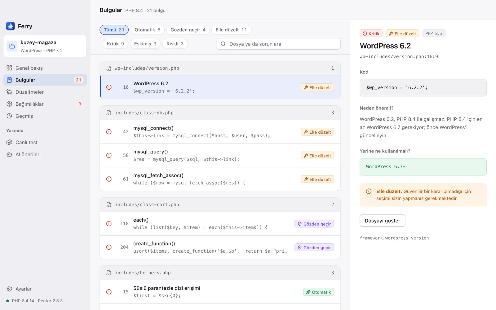
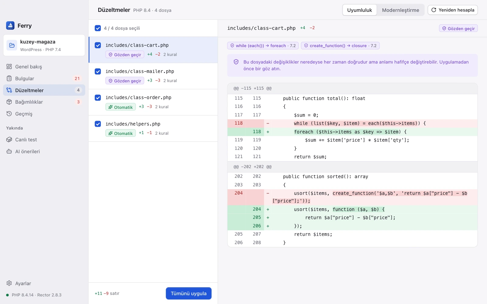
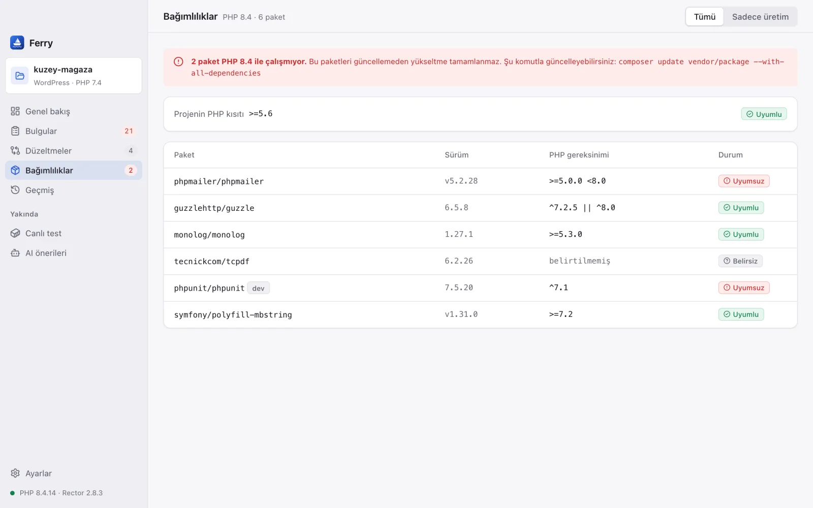
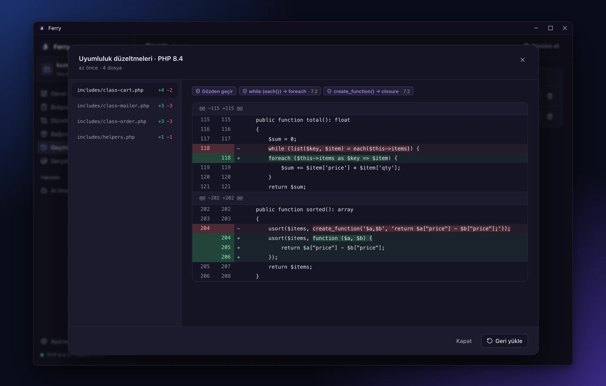

# Ferry

**PHP projenizi yeni sürüme taşırken nelerin bozulacağını önceden görün, güvenle düzeltin.**

Ferry, macOS, Windows ve Linux'ta çalışan bir masaüstü uygulamasıdır. PHP kodunuzu tarar, geçmek istediğiniz sürümde nelerin bozulacağını gösterir ve Rector'ın önerdiği düzeltmeleri yalnızca siz onayladıktan sonra uygular. Her değişiklikten önce yedek alır. Hesap açmanız gerekmez; kodunuz bulutta değil, kendi bilgisayarınızda kalır.

[](../../releases/latest)

    [](LICENSE)

[Özellikler](#özellikler) · [Kurulum](#kurulum) · [Gizlilik](#gizlilik) · [Nasıl çalışır](#nasıl-çalışır) · [Kaynaktan derleme](#kaynaktan-derleme) · [English](README.md)


- **Sorunları kullanıcılarınızdan önce görün.** PHP 7.0 ile 8.5 arasında kaldırılan ya da değişen kod; dosyası, satırı ve neden önemli olduğuyla listelenir. Taramanın neyi bulup neyi bulamayacağını [docs/COVERAGE.md](docs/COVERAGE.md) gösterir.
- **Siz onaylamadan hiçbir şey değişmez.** Rector yalnızca deneme modunda çalışır. Her değişikliği satır satır inceler, yalnızca seçtiğiniz dosyaları uygularsınız.
- **Her değişikliği tek tıkla geri alın.** Her uygulamadan önce yedek alınır. Geri dönmek için Git kullanmanız gerekmez.

## Öne çıkan özellikler

- **Önünüzdeki işin büyüklüğünü görün.** 0 ile 100 arasındaki hazırlık puanı ve düzeltmelerin otomatik, gözden geçirilecek ve elle yapılacak olarak dağılımı, geçişin ne kadar süreceğini bir bakışta gösterir.
- **Hangi düzeltmeye güvenebileceğinizi bilin.** Her bulgu ve her değişiklik etiketlidir: **Otomatik** (davranışı korumak için tasarlanmış, kurala dayalı bir dönüşüm), **Gözden geçir** (genellikle doğrudur ama bakmaya değer) ya da **Elle düzelt** (kararı sizin vermeniz gerekir).
- **Yalnızca gerekeni düzeltin ya da kodu modernleştirin.** **Uyumluluk** modu yalnızca kodun yeni sürümde çalışması için gerekenleri değiştirir. **Modernleştirme** ise `match`, constructor promotion ve `str_contains` gibi yeni yazımları da benimser.
- **Sizi geride tutan paketleri bulun.** Ferry `composer.lock` dosyasını okur ve hedef sürümü desteklemeyen paketleri, koda dokunmaya başlamadan önce gösterir.
- **Diske yazılan, önizlemede gördüğünüzün aynısıdır.** Değişiklikleri Ferry, sizin gördüğünüz haliyle kendisi uygular. Önizlemeden sonra değişen bir dosyaya dokunmaz.
- **Taramaya başlamak için kurulum gerekmez.** Tarayıcı Ferry'nin içindedir ve PHP gerektirmez. PHP ve Composer yalnızca otomatik düzeltmeler için gerekir; Rector'ı da Ferry sizin için kurar.

## Özellikler

### Hedef sürümünüz için hazırlık puanı

Geçmek istediğiniz sürümü seçin (PHP 8.2 ile 8.5 arası); Ferry tüm PHP dosyalarını saniyeler içinde tarar. **Genel bakış** ekranında şunları görürsünüz:

- projenin platformu ([Desteklenen projeler](#desteklenen-projeler) altındaki on platformdan biri ya da düz PHP), PHP dosyası sayısı ve `composer.json`'a göre şu anki PHP sürümü
- 0 ile 100 arasında bir hazırlık puanı ve her düzeltme türüne düşen sorun sayısı; puan kalan işin bir tahminidir, uygulamanın çalışacağının garantisi değildir
- puanın yanında hâlâ önünüzde duranlar: geçişi engelleyen sorunlar, taramanın kapsayamadığı dosyalar, engel çıkaran ya da doğrulanamayan bağımlılıklar ve hedef sürümde lint ya da testin çalışıp çalışmadığı. Başlık ancak bunların hepsi temizse projenin hazır olduğunu söyler
- bulguların kaçının **Kritik** (kod çalışmaz), **Eskimiş** (şimdilik uyarı verir, ileride kaldırılır) ya da **Riskli** (çalışırken farklı davranabilir) olduğu
- en sık görülen sorunlar ve atmanız gereken sonraki adımlar

Her sayı bir kısayoldur: **Kritik**'e, **Elle düzelt**'e ya da en sık görülen sorunlardan birine tıklayın, **Bulgular** tam olarak onlara süzülmüş hâlde açılır. Hedef sürümü değiştirdiğinizde proje hemen yeniden taranır; düzeltmeleri hesapladıysanız Ferry onları silmeden önce sorar.

Bakımını sizin yapmadığınız framework kodu kendiliğinden atlanır: WordPress'te `wp-admin` ve `wp-includes`, Laravel'de `storage` ve `bootstrap/cache`, Symfony'de `var`, Drupal çekirdeği; her projede de `vendor` ve `node_modules`. Atlanan klasörler genel bakışta yazılıdır.

**Hedefleri karşılaştır** projeyi PHP 8.2, 8.3, 8.4 ve 8.5 için aynı anda tarar; puanı, kritik, eskimiş ve elle düzeltilecek bulguları ve engelleyen paketleri yan yana gösterir. Böylece doğrudan 8.5'e geçmenin 8.3'te durmaktan ne kadar fazla iş çıkaracağını görürsünüz. **Bu hedefe geç** birini seçer.

İkinci taramadan sonra **Son taramadan beri** kaç bulgunun çözüldüğünü, kaçının yeni olduğunu ve o hedef için her taramanın hazırlık puanını bir eğri olarak gösterir. Ferry her hedef için son 30 taramayı projede değil, kendi veri klasöründe tutar.

**Rapor al** ile sonuçları bir Markdown dosyasına kaydedebilir, bir iş kaydına ekleyebilir ya da ekibinizle paylaşabilirsiniz.

### Her bulgu, açıklamasıyla

**Bulgular** sayfası her sorunu dosyasına göre gruplar; satırını, kodunu ve düzeltme türünü gösterir. Dosyalarda ve sorunlarda arama yapabilir, düzeltme türüne ya da önem derecesine göre süzebilir ve kaç bulgunun eşleştiğini görebilirsiniz. Genel bakışta seçtiğiniz bir kural kaldırılabilir bir süzgeç olarak görünür; **Filtreleri temizle** hepsini sıfırlar. Sayfa değiştirdiğinizde süzgeçler korunur.



Bir bulguyu seçtiğinizde şunları görürsünüz:

- soruna yol açan kod
- neden önemli olduğu ve hangi PHP sürümünden beri geçerli olduğu
- yerine ne kullanmanız gerektiği
- otomatik olarak düzeltilip düzeltilemeyeceği

**Dosyayı göster** dosyanın bulunduğu klasörü açar. **Editörde aç** ise dosyayı **Ayarlar**'da seçtiğiniz editörde (Visual Studio Code, Cursor, PhpStorm, Sublime Text, Zed, sistem varsayılanı ya da `emacsclient -n +{line}:{column} {file}` gibi `{file}`, `{line}` ve `{column}` içeren özel bir komut veya adres) ilgili satırda açar. Listede ok tuşlarıyla gezinebilirsiniz.

Bir bulgunun sizin için geçerli olmadığına karar verdiyseniz (örneğin yalnızca eski sunucuda çalışan bir kod) **Yok say** onu listeden ve puandan çıkarır. Ferry bir gerekçe ister ve bunu projedeki `.ferry/ignore.json` dosyasına yazar; bu dosyayı depoya eklerseniz karar kodla birlikte taşınır. Eşleştirme kural, dosya ve kod üzerinden yapılır, bu yüzden üstteki satırlar kaysa da bulgu yok sayılmaya devam eder. Bulgular sayfasındaki **Yok sayılanlar** bunları gerekçeleriyle listeler, **Yeniden göster** bir bulguyu geri getirir.

**Log içe aktar**, kod çalışırken gerçekten ne olduğunu ekler. Bir PHP hata log'u (`php_errors.log`, Apache'nin `error_log` dosyası) `phpunit --display-deprecations` çıktısı, Monolog JSON log'u ya da Symfony PHPUnit bridge özeti seçin; tercihen hedef sürümde yapılmış bir çalıştırmanın çıktısı olsun. Her kullanımdan kalkma, uyarı ya da ölümcül hata projedeki dosya ve satırla eşleştirilir: Mesaj o satırdaki bulguyla uyuşuyorsa bulguya **Çalışırken ×N** rozeti eklenir (ölümcül hata yalnızca **Kritik** bir bulguyu doğrular, başka bir fonksiyonu adlandıran mesaj sayılmaz); diğer her mesaj ayrı bulgu olarak eklenir. Bir mesaj ancak yolu açıkça bu projeye aitse projeye bağlanır: bir alt klasördeki dosya, aynı klasörde iki ya da daha fazla dosya ya da projeyle aynı adı taşıyan bir klasör. Başka projelerin mesajları proje dışı sayılır. Ortak bir log yine de yanlışlıkla eşleşebilir, bu yüzden **sunucudaki proje kökünü** yazabilirsiniz; o zaman yalnızca bu kökün altındaki yollar sayılır. **Çalışırken görülenler** listeyi bunlara süzer. Log, siz kaldırana ya da projeyi kapatana kadar bellekte durur. CI'da aynısını `ferry-cli --runtime-log <dosya>` yapar, kök için `--runtime-root <yol>` eklenir. Bridge özetinde dosya ve satır yoktur; bu yüzden yalnızca aynı fonksiyonu ya da sınıfı anan bulguları doğrular, kalanlar proje dışı sayılır. Dolaylı ve eski (legacy) gruplar alınmaz.

Hedef PHP sürümü bu bilgisayarda kuruluysa (Homebrew, Herd, MAMP, Laragon, phpenv ya da `php8.x` adlı bir çalıştırılabilir dosya), Bulgular sayfası iki seçenek daha sunar: **PHP 8.x ile lint et** her dosyada o PHP ile `php -l` çalıştırır; **Testleri PHP 8.x ile çalıştır** önce sorar, sonra `vendor/bin/phpunit`'i çalıştırır. Çıkan uyarılar, içe aktarılan bir log gibi bulgularla birleştirilir. Sonuç listenin üstünde kalır: kaç dosyanın lint edildiği ya da kontrol edilemediği, testlerin geçtiği, başarısız olduğu (çıkış koduyla) ya da süre sınırında durdurulduğu ve komutun çıktısı.

Bir bulguyu kodun içinde de yok sayabilirsiniz: Aynı satıra ya da bir üst satıra yazılan `// ferry-ignore removed.each yalnızca PHP 5 sunucusunda çalışıyor` yorumu o kuralı orada yok sayar. `removed.*` bir grubu, yalnızca `// ferry-ignore` ise o satırdaki bütün kuralları kapsar. Yalnızca gerçek yorumlar sayılır, şablonlardaki `<!-- ferry-ignore -->` da buna dahildir; aynı sözcükler bir string'in içindeyse sayılmaz. Bu şekilde yok sayılan bir bulgu yorum kaldırılınca yeniden görünür, bu yüzden ayrıntı panelinde **Yeniden göster** düğmesi çıkmaz. `.ferry/ignore.json` içindeki bir kayıt kod değiştiği ya da silindiği için artık hiçbir kodla eşleşmiyorsa Bulgular sayfası bunu söyler ve kaydı silmeyi önerir.

Ferry'nin kendi PHP sözcük çözümleyicisi ve kural seti vardır; kodu PHP'nin okuduğu gibi okur. `$db->each()` gibi metot çağrıları, kendi namespace'inizdeki fonksiyonlar, metinlerin ve yorumların içindekiler kaldırılmış fonksiyon sanılmaz. Kurallar şunları kapsar:

- `mysql_*`, `ereg*`, `each()`, `create_function()` ve `money_format()` gibi kaldırılan eklenti ve fonksiyonlar
- PHP 7.0'dan 8.5'e kadar kaldırılan ya da kullanımdan kalkan bütün yerleşik fonksiyon, sınıf, metot ve sabitler; tablo PHP'nin kendi reflection verisinden üretilir (örneğin 8.0'da kaldırılan DOM sınıfları, `SplFixedArray::rewind()`, eski tarz `parent::SoapClient()` kurucu çağrıları ve 8.4'te kaldırılan `MYSQLI_*` sabitleri)
- `$str{0}`, `(real)` ve `(unset)` dönüşümleri, `$obj = &new Foo`, `$args = &func_get_args()`, `unset($this)`, `$GLOBALS` dizisinin tamamına yazma, `Object` gibi ayrılmış adların `use` takma adı olarak kullanılması, döngü dışındaki `break` ve PHP 8'in attribute olarak okuduğu PHP 7 `#[` yorumları gibi artık ayrıştırılamayan ya da derlenemeyen yazımlar
- `"${var}"` yerleştirmesi, örtük nullable parametreler, `utf8_encode()`, `FILTER_SANITIZE_STRING` ve `E_STRICT` gibi kullanımdan kalkanlar
- zorunlu bir parametreden önce gelen isteğe bağlı parametre, yerleşik metin fonksiyonlarına doğrudan verilen `null` ve `"self::method"` biçimindeki callable'lar gibi parametre ve çağrı kalıpları
- yerleşik bir sınıfın ya da arayüzün metodunu PHP 8'in kabul etmediği bir imzayla ezen ve sınıfın hiç yüklenmemesine yol açan metotlar; örneğin Drupal 7'nin bir `PDO` alt sınıfındaki `query($query, array $args = array(), $options = array())` metodu
- projedeki bir üst sınıfın, trait'in ya da arayüzün metodunu PHP 8'in kabul etmediği bir imzayla ezen metotlar; örneğin phpBB 3.2'nin üst sınıfta isteğe bağlı olan parametreyi zorunlu yapan `create_insert_array($user, $pre_create_data)` metodu. PHP 7 bunu yalnızca uyarıyla geçiyordu
- `PDO::query()` ya da `Iterator::current()` gibi yerleşik bir sınıfın ya da arayüzün metodunu dönüş tipi olmadan ezen ve PHP 8.1'den itibaren `#[\ReturnTypeWillChange]` isteyen metotlar
- yeni sürümde çalışmayı bırakan kodlar: PHP'ye sonradan eklenen bir fonksiyonu ya da sınıfı (`str_contains()`, `JsonException`) `function_exists()` kontrolü olmadan tanımlamak, statik olmayan bir metodu `Sinif::metot()` ile çağırmak, kendi fonksiyon, metot ve constructor'larınıza eksik argümanla yapılan çağrılar, yerleşik fonksiyonlara yanlış sayıda argüman (`mktime()`, `crypt($pw)`), beşinci `$errcontext` parametresini zorunlu tutan hata işleyiciler, `Exception` tipli istisna işleyiciler, üst sınıfı olmayan sınıfta `parent::`, `preg_replace()` içindeki `/e` belirteci ve artık nesne olan curl, GD ya da pgsql değerleri için `is_resource()`
- PHP 8'de artık hiç tutmayan, `@` için yazılmış `error_reporting() == 0` kontrolleri
- `eval()`, `extract()` ve değişken değişkenler gibi elle kontrol edilmesi gereken kodlar

Ferry, hangi PHP'nin gerçekten çalışacağını belirleyen ve kodun çevresinde duran dosyaları da okur:

- `.htaccess`: PHP-FPM'de 500 hatası veren ve `<IfModule mod_php.c>` dışında kalan `php_value` ve `php_flag` satırları ile PHP 8'in artık eşleşmediği `<IfModule mod_php5.c>` ya da `mod_php7.c` blokları
- `.user.ini`, `php.ini` ve `.htaccess` içinde PHP'nin kaldırdığı ya da kullanımdan kaldırdığı ayarlar: `register_globals` (açıkken PHP hiç başlamaz), `track_errors`, `allow_url_include` ve `session.trans_sid_hosts` gibi
- `platform-check` seçeneği kapatılmış ya da `config.platform.ext-*` değerleri eski sürümde sabitlenmiş bir `composer.json`, Composer 1 ile oluşturulmuş bir `composer.lock` ve yalnızca Composer 1 ile çalışan Composer eklentileri
- `Dockerfile` (`ARG PHP_VERSION` dahil), Docker Compose (derleme argümanları dahil), GitHub Actions (`container:`, `docker run` ve YAML listeleri dahil), GitLab CI, Travis, Bitbucket Pipelines, DDEV, Lando, Platform.sh, `.conf` dosyaları ve Caddyfile'lardaki PHP-FPM soket yolları, `.tool-versions`, `.php-version` ve `composer.json`'daki `config.platform.php` içinde hedefinizin altında sabitlenmiş PHP sürümleri. Düzeltmeler ekranındaki **Sürüm dosyaları** modu ya da `ferry-cli pins <proje> --write` bunları günceller

### Her değişikliği uygulamadan önce inceleyin

**Düzeltmeler** sayfası Rector'ı projenizde deneme modunda çalıştırır; hiçbir dosya değişmez. Değişen her dosyanın farkını satır satır, değişikliği üreten kuralları ve ona ne kadar güvenebileceğinizi görürsünüz.



- **Uyumluluk** yalnızca yeni sürümde çalışmak için gerekenleri değiştirir. Başlamak için en doğru yer burasıdır.
- **Modernleştirme** hedef sürümün yeni yazımlarını da benimser.
- **Adım**, yolda bir sürümde durur; örneğin 7.4'ten 8.4'e geçerken 8.0'da. Bir sürümün düzeltmelerini uygular, sonra bir sonrakine geçersiniz; böylece her grup küçük kalır. Tarama yine hedefe göre raporlar.
- İstediğiniz dosyaları seçin, gerekirse dosyanın farkındaki tek tek değişikliklerin işaretini kaldırın ve **Uygula**'ya basın. Otomatik dosyalar seçili gelir; **Gözden geçir** olarak işaretlenen dosyalar seçilmemiş gelir ve önce kontrol etmeniz için bir not taşır. Açmadığınız dosyalarda **Bakılmadı** yazar; onay penceresi kaç otomatik ve kaç gözden geçirilecek dosya uyguladığınızı ve farkına bakmadığınız dosya olup olmadığını söyler.
- **Seçimi daralt** yalnızca otomatik düzeltmeleri ya da belirli bir Rector kuralının değiştirdiği dosyaları seçer; böylece her seferinde tek tür değişikliği uygulayıp commit edebilirsiniz. Seçim dosya bazlıdır: seçilen dosyalardaki diğer değişiklikler de uygulanır.
- Git projelerinde onay penceresi, seçilen dosyalardan commit edilmemiş değişikliği olanları listeler ve uygulanan kuralları sayan, kopyalamaya hazır bir commit mesajı önerir.
- Uyguladıktan sonra Ferry değişen dosyaları `php -l` ile kontrol eder; bir değişiklik dosyayı ayrıştırılamaz hâle getirdiyse sizi uyarır, böylece **Geçmiş**'ten hemen geri alabilirsiniz.

Ferry, Rector'ın tek başına çözemediği durumları da ele alır. Örneğin `$str{0}` yazımı içeren bir dosyayı Rector tamamen atlar. Ferry bu yazımları önce `$str[0]` olarak düzeltir, aynısını `= &new`, `= &func_get_args()` ve `default;` için de yapar; böylece dosyanın geri kalanı da düzeltilir.

### Geçişi engelleyen bağımlılıklar

**Bağımlılıklar** sayfası, kilitli her paketi `composer.lock`'ta bildirdiği PHP gereksinimine göre hedef sürümle karşılaştırır. Projenin `composer.json`'daki kendi PHP kısıtı da kontrol edilir. `composer.json`'da ya da kilitli bir pakette `php` için yazılmış bir `conflict` kaydı da hesaba katılır.

`^8.0` gibi bir gereksinim, paketin en yeni PHP'de çalıştığı anlamına gelmeyebilir. Laravel (`laravel/framework`, `illuminate/*`), Drupal çekirdeği ve Symfony'nin çekirdek paketleri için Ferry, framework'ün yayımladığı destek aralığını da kullanır ve farkı gereksinimin altında açıklar.

Projenin kendisinin istediği `symfony/polyfill-php80` ya da `paragonie/random_compat` gibi polyfill'lere, hedef PHP eklediklerini zaten içerdiğinde bir not düşülür.



Her paket **Uyumlu**, **Uyumsuz** ya da **Belirsiz** (paket bir PHP gereksinimi bildirmiyorsa ya da Ferry bunu okuyamıyorsa) olarak işaretlenir; uyumsuz paketler listenin başında yer alır. Engel yokken bazı paketler belirsizse sayfa her şeyi uyumlu saymaz, bunu ayrıca belirtir. Geliştirme paketleri etiketlidir; **Sadece üretim** seçeneği onları gizler. Listenin üstündeki uyarı, geçişi engelleyen paketleri tek tek adıyla içeren, kopyalamaya hazır bir `composer update` komutu verir.

**Uyumlu sürümleri bul**, engelleyen her paketin hangi sürüme geçmesi gerektiğini Packagist'e sorar. Önerilen sürüm, PHP gereksinimi (ve Ferry'nin bildiği durumlarda framework'ün kendi destek aralığı) hedefe izin veren ilk ana sürümün en yenisidir. İnternete çıkan tek özellik budur ve yalnızca siz tıkladığınızda çalışır.

WordPress projelerinde **WordPress eklentileri ve temaları** her eklentiyi ve temayı kurulu sürümü, `Requires PHP` başlığı ve kendi kodunda bulunan kritik sorunlarla listeler. **En son sürümleri bul** her biri için api.wordpress.org'dan güncel sürümü sorar ve orada kaldırılmış eklentileri işaretler.

**Sunucu**, geçeceğiniz makineyi kontrol eder. **Yoklama dosyası oluştur** yalnızca rastgele anahtarıyla yanıt veren tek dosyalık bir `ferry-probe.php` kaydeder. Bu dosyayı sunucunun web klasörüne yükleyip `https://siteniz/ferry-probe.php?token=…` adresini açın ve yazdırdığı JSON'u yapıştırın. Ferry bunu hedefle karşılaştırır: sunucudaki PHP sürümü (ve güvenlik açığı olan bir sürüm olup olmadığı), çalışma biçimi (`.htaccess` içindeki `php_value` satırlarının bozulduğu PHP-FPM), kodun kullanıp sunucuda olmayan eklentiler, `disable_functions` ve `memory_limit`. İşiniz bitince dosyayı sunucudan silin.

**PHP eklentileri**, kodun kullandığı her eklentiyi (`mysqli`, `gd`, `intl` gibi) kaç kez ve ilk nerede kullanıldığıyla listeler. `composer.json`'da `ext-*` olarak belirtilip belirtilmediğini ve bu bilgisayardaki PHP'de olup olmadığını gösterir. PHP'den çıkarılan eklentiler (8.4'te `imap` gibi) işaretlenir. `composer.json`'da belirtilmeyenler için yapıştırmaya hazır `ext-*` satırları önerilir; böylece Composer yeni sunucuda da bunları kontrol eder.

### Her şeyi Geçmiş'ten geri alın

Ferry her uygulamadan önce değiştireceği dosyaları yedekler. **Geçmiş** sayfası her uygulamayı zamanı ve dosya sayısıyla listeler.



- **İncele**, her uygulamanın neyi değiştirdiğini dosya dosya ve her değişikliğin ardındaki kurallarla birlikte gösterir.
- **Geri yükle**, o uygulamadan önceki halleriyle bütün dosyaları geri getirir. Bunlardan birini sonradan düzenlediyseniz Ferry önce o dosyaları listeler ve şu anki içeriklerini Geçmiş'e yeni bir kayıt olarak yedekler; onayladıktan sonra değişen bir dosyanın üzerine ise yazmaz.
- **Ayarlar**'daki **Saklanacak yedek** seçeneği her projede tutulacak yedek sayısını sınırlar (10, 30 ya da 100). Varsayılanı sınırsızdır.
- Bir uygulama yarıda kalırsa Ferry dosyaları kendiliğinden geri alır. Bu da başarısız olursa yedek Geçmiş'te kalır; oradan kendiniz geri yükleyebilirsiniz.

### Masaüstünüz için tasarlandı

- **Türkçe ve İngilizce** arayüz. Seçtiğiniz dil dışa aktarılan raporlarda da kullanılır.
- **Açık ve koyu** tema ya da sistemin teması.
- Proje klasörünü pencereye **sürükleyip bırakın** ya da başlangıç ekranından son projelerinizi yeniden açın.
- **Yeniden boyutlandırılabilir paneller:** **Bulgular** ve **Düzeltmeler** sayfalarında liste ile ayrıntı arasındaki çizgiyi sürükleyin ya da çizgiye odaklanıp ok tuşlarını kullanın. Boyut hatırlanır; sıfırlamak için çizgiye çift tıklayın.
- **Klavye kısayolları:** **⌘O** proje açar, **⌘1**–**⌘5** sayfalar arasında geçiş yapar, **⌘,** **Ayarlar**'ı açar, **⌘+** / **⌘−** arayüzü yakınlaştırır ya da uzaklaştırır. Windows ve Linux'ta **⌘** yerine **Ctrl** kullanın.
- **Erişilebilir:** Her şey klavyeyle yapılabilir ve odak her zaman görünür. Testlerde her ekran ve pencere axe ile kontrol edilir, native e2e de gerçek uygulama penceresinde iki temada metin kontrastını WCAG 2.1 AA ölçütüne göre ölçer. Ekran okuyucu davranışı otomatik olarak test edilmez. Yüksek yakınlaştırmada paneller alt alta dizilir, kenar çubuğu simgelere iner.

### CI için komut satırı

`ferry-cli` aynı taramayı pencere açmadan yapar. Böylece hedef sürümde çalışmayacak kod ekleyen bir değişiklik, CI hattında birleştirilmeden durdurulabilir. `.ferry/ignore.json` dosyasını okuduğu için uygulamada yok saydığınız bulgular CI'da da yok sayılır.

```bash
cargo build --release -p ferry-cli
target/release/ferry-cli scan . --target 8.4 --format github
```

- `--format text|json|sarif|github|junit|checkstyle|csv`: düz metin, özet ve yok sayılan bulgularla birlikte JSON, GitHub code scanning ve benzeri araçlar için SARIF 2.1.0, değişen satırlarda GitHub Actions uyarıları, Jenkins ve GitLab test raporları için JUnit XML, Checkstyle XML ya da tablolar için CSV. `--blame` CSV'ye her satırın `git blame` yazarını ekler; böylece iş ekip içinde paylaştırılabilir.
- `--fail-on breaking|deprecated|any|none`: komutun 1 koduyla çıkması için gereken en düşük önem derecesi (varsayılanı `breaking`). Klasörün bulunamaması gibi hatalarda çıkış kodu 2'dir.
- `--allow-incomplete`: Bazı dosyaları okuyamayan bir tarama (örneğin 2 MB'ı aşan bir dosya) varsayılan olarak 3 koduyla çıkar, bu dosyaları stderr'e yazar ve her formatta bildirir (JSON'da `complete`, `filesFound` ve `errors`, SARIF'te `executionSuccessful`). Bu seçenek böyle bir taramanın geçmesine izin verir; action'daki karşılığı `allow-incomplete` girdisidir.
- `--output <dosya>` raporu bir dosyaya yazar, `--lang tr` mesajları Türkçe yapar.
- `--write-baseline <dosya>` bugünkü bulguları kaydeder, `--baseline <dosya>` ise onlarla karşılaştırır: `--fail-on` için yalnızca baseline'da olmayan bulgular sayılır, `--fail-on new` bunlardan herhangi biri varsa başarısız olur. Böylece yüzlerce eski bulgusu olan bir projede yenilerin eklenmesi engellenebilir.

Projenin ayarları `.ferry/ignore.json` dosyasının yanındaki `.ferry/config.json` dosyasında durabilir. Dosyayı git'e eklerseniz uygulama, ekibiniz ve `ferry-cli` aynı seçimlerle başlar. Ayarlar ve Docker ekranı dosyayı sizin için yazar:

```json
{
  "target": "8.4",
  "exclude": ["legacy"],
  "baseline": ".ferry/baseline.json",
  "docker": {
    "source": "7.4",
    "extensions": true,
    "pages": ["/", "/login"],
    "dump": "database/dump.sql",
    "prepare": "php bin/console sass:build",
    "test": "vendor/bin/pest"
  },
  "git": {
    "requireClean": true,
    "branchPerBatch": true
  }
}
```

`requireClean`, projede commit edilmemiş dosya varken uygulamanın değişiklik yazmasını engeller. `branchPerBatch`, bir düzeltme grubunu ayrı bir `ferry/php-X.Y-…` dalına alıp yalnızca o dosyaları commit eden seçeneği işaretli getirir. Ferry bu commit için projenin Git kancalarını çalıştırmaz; Geçmiş'teki geri alma commit'i silmez, dosyaları onun üstüne geri yükler.

Komut satırı seçenekleri dosyanın önüne geçer ve `--target` zorunlu olmaktan çıkar. Yollar proje içinde olmalıdır. Sunucu bağlantıları kaydedilemez, çünkü her kopyalama onay ister. Kayıtlı `prepare` ve `test` komutları yalnızca container içinde çalışır ve uygulama başlatmadan önce bunları gösterir.

Docker çalışırken **Gerçek test** ekranı ya da `ferry-cli compare <proje> --target 8.5`, projeyi `php:X.Y-cli` container'larında mevcut ve hedef sürümde lint eder, PHPUnit testlerini çalıştırır ve hedefte yeni çıkanları listeler. Container'lar kopyalar üzerinde ve ağ erişimi olmadan çalışır; ağa yalnızca `composer install` çıkar, o da projenin script ve eklentileri olmadan. Projenin kullandığı `mysqli` ya da `gd` gibi eklentiler önce [docker-php-extension-installer](https://github.com/mlocati/docker-php-extension-installer) ile (sağlama toplamı sabit) yerel bir `ferry-php` kalıbına kurulur ve bu kalıp yeniden kullanılır. Kalıp hazırlanırken proje kodu çalışmaz. `--no-extensions` ya da uygulamadaki onay kutusu bu adımı atlar; yine de eksik kalanlar listelenir. Sayfalar da container içinde `php -S` ile açılır; `/` adresinden başlayıp bağlantılar yalnızca GET ile izlenir, durum kodu, yönlendirme, PHP hataları ve içerik karşılaştırılır. Sayfalar `APP_ENV=prod` ile çalışır, hatalar sayfaya değil loga yazılır; böylece hata ayıklama çıktısı sonucu değiştirmez. Token ve saatler yok sayılır, farklı sayfalarda ilk farkın yeri gösterilir. `--prepare <komut>` kopyada ağ erişimiyle bir kez çalışır, örneğin varlıkları derlemek için. `.ferry/config.json` içine kaydedilmiş `prepare` ya da `test` komutu projeden gelir; uygulama onu gösterip sorar, CLI ise `--allow-config-commands` ister. `--page <yol>` başlangıç sayfası ekler, `--no-pages` ya da uygulamadaki onay kutusu bu adımı atlar. Her sürüm kendi veritabanını da alabilir: `--db-dump <dosya>` bir `.sql` ya da `.sql.gz` dosyasını içe aktarır, `--db-live` projenin `.env` ya da `wp-config.php` bilgileriyle bu bilgisayardaki SQLite dosyasını ya da MySQL, MariaDB veya PostgreSQL veritabanını kopyalar, `--db-seed` Laravel ya da Symfony migration ve seeder'larını bir kez çalıştırıp iki sürüme aynı satırları verir. `--db-ssh <sunucu:veritabanı:kullanıcı>` kendi `ssh` ve `ssh-agent` ayarınızla sunucudan kopyalar, yalnızca salt okunur `mysqldump` ya da `pg_dump` çalıştırır. Uygulama her kopyadan önce sunucu ve veritabanını göstererek onay ister. Projedeki veritabanı parolası sunucuya yalnızca o seçeneği işaretlerseniz ya da `--db-ssh-password` verirseniz gider. Ferry anahtar ya da parola saklamaz; veri kişisel olabilir ve bilgisayarınızda işlenmesinin sorumluluğu size aittir. Uygulamada da aynı seçenekler vardır. Veriler geçici klasör ve container'larda kalır, kopyanın ayarları kendi veritabanına yönlendirilir, kodda sabit `localhost` kullanan uygulamalar MySQL'e paylaşılan soket üzerinden bağlanır, canlı veritabanına yazılmaz ve istekler sonrası farklı tablolar listelenir. Veritabanı olmadan, veritabanı isteyen sayfalar karşılaştırılamadı olarak işaretlenir. Sonuç Genel Bakış'ta, Geçmiş'te ve dışa aktarılan raporda da görünür. Karşılaştırma sorun bulursa **Düzelt ve yeniden test et** Ferry'nin düzeltmelerini hazırlar ve hangilerinin hata veren satırlarda olduğunu gösterir. Seçtikleriniz yalnızca hedef sürümün geçici kopyasına yazılır; böylece eski kod eski sürümde, düzeltilmiş kod yeni sürümde karşılaştırılır. Ardından neyin kapandığını, neyin kaldığını ve neyin yeni çıktığını görürsünüz. Projeniz yalnızca düzeltmeleri yazdığınızda değişir; yedek ve geri alma Değişiklikler sayfasındakiyle aynıdır. İkinci çalıştırma veritabanı kopyasını yineler, sunucudan kopyalamada yeniden onay ister. Davranış farkları, başarısız testler ve bağımlılık sorunları otomatik düzeltilmez. Yeni mesajlar kaynağına göre gruplanır: sizin kodunuz, framework ya da CMS çekirdeği, Composer paketi veya WordPress eklentisi ya da teması. Her grup için sonraki adım yazar ve paketin uyumlu sürümü oradan Packagist'te aranabilir. `--test <komut>` PHPUnit yerine örneğin Pest çalıştırır ve sonucu çıkış kodu belirler. `--try-fixes <rector>` aynı denemeyi güvenli düzeltmelerle yapar ve projeye hiçbir şey yazmaz. Bu kalıplar 600–750 MB yer tutar. Karşılaştırma bitince silmek için `--clean-images` ya da yanındaki onay kutusunu, istediğiniz zaman silmek için Ayarlar'ı ya da `ferry-cli clean-images` komutunu kullanın. Resmî `php` kalıpları kalır.

Depo aynı zamanda `ferry-cli`'ı derleyip pull request'lere uyarı ekleyen bir GitHub Action'dır:

```yaml
- uses: efekoca/ferry@main
  with:
    target: "8.4"
    baseline: .ferry/baseline.json
    fail-on: new
```

`sarif: "true"` verirseniz `github/codeql-action/upload-sarif` için `ferry.sarif` de yazılır.

## Desteklenen projeler

| Proje türü | Nasıl tanınır | Kendiliğinden atlananlar |
|---|---|---|
| **WordPress** | `wp-config.php`, `wp-config-sample.php` ya da `wp-includes` klasörü | `wp-admin`, `wp-includes` (çekirdek); temalarınız ve eklentileriniz taranır |
| **Laravel** | `artisan` dosyası ya da `composer.json`'da `laravel/framework` | `storage`, `bootstrap/cache` |
| **Symfony** | `composer.json`'da `symfony/framework-bundle` ya da `bin/console` | `var` |
| **Drupal** | `composer.json`'da `drupal/core`, `core/lib/Drupal.php` (`web/`, `docroot/`, `html/` veya `public/` altında da) ya da Drupal 7'nin `includes/bootstrap.inc` dosyası | Drupal çekirdeği, `sites/default/files` |
| **Magento** | `app/Mage.php` (Magento 1), `bin/magento` ya da `composer.json`'da bir `magento/product-*` paketi | `generated`, `var`, `pub/static`, `setup`, `dev`; Magento 1'de `app/code/core` ve `lib` |
| **PrestaShop** | `config/settings.inc.php`, `app/AppKernel.php` ya da `classes/PrestaShopAutoload.php` | `classes`, `controllers`, `src`, `app` gibi çekirdek klasörleri; `modules`, `override` ve `themes` taranır |
| **Joomla** | `administrator` klasörüyle birlikte `libraries/src/Version.php` ya da Joomla 3'ün `libraries/cms/version/version.php` dosyası | `cache`, `tmp`, `administrator/cache`, `libraries/vendor`, `media` |
| **Moodle** | `lib/moodlelib.php` ile birlikte `version.php` (5.1'den itibaren `public/version.php`) | `vendor` klasörleri |
| **MediaWiki** | `includes/Defines.php` içindeki `MW_VERSION` ya da `includes/DefaultSettings.php` içindeki `$wgVersion` | `includes`, `languages`, `maintenance`, `resources` gibi çekirdek klasörler; `extensions` ve `skins` taranır |
| **phpBB** | `includes/constants.php` içindeki `PHPBB_VERSION` (`phpBB/` altında da aranır) | `phpbb`, `includes`, `cache`, `install` gibi çekirdek klasörler; `ext` ve `styles` taranır |
| **CodeIgniter** | `system/CodeIgniter.php`, `system/core/CodeIgniter.php` ya da `composer.json`'da `codeigniter4/framework` | `system`, `writable` |
| **Yii** | `composer.json`'da `yiisoft/yii2` ya da `yiisoft/yii`, veya Yii 1'in `framework/YiiBase.php` dosyası | `framework`, `runtime`, `web/assets`, `protected/runtime`, `assets` |
| **CakePHP** | `composer.json`'da `cakephp/cakephp`, ya da CakePHP 2'nin `lib/Cake/VERSION.txt` dosyası | `lib/Cake`, `tmp`, `logs`, `app/tmp` |
| **OpenCart** | `catalog/controller` ile birlikte `system/startup.php` (`upload/` altında da) | `system`, `image`, `install`; `admin`, `catalog` ve `extension` taranır |
| **Düz PHP** | PHP dosyası içeren her klasör | — |

WordPress, Laravel, Drupal, Magento, PrestaShop, Joomla, Moodle, MediaWiki, phpBB, CodeIgniter, Yii, CakePHP, OpenCart ve Symfony projelerinde Ferry platformun kendisini de kontrol eder:

- **WordPress:** `wp-includes/version.php`'deki çekirdek sürümü, hedef PHP sürümünü destekleyen en eski WordPress sürümüyle karşılaştırılır (örneğin PHP 8.4 için en az WordPress 6.7 gerekir).
- **Laravel:** `composer.lock`'taki `laravel/framework` sürümü Laravel'in desteklediği PHP aralığıyla karşılaştırılır. Ayrıca Laravel 6'nın kaldırdığı `str_*` ve `array_*` yardımcıları ile `Input` facade'ı işaretlenir; PHP 8 en az Laravel 6.20 gerektirdiği için `laravel/helpers` kurulu değilse bunlar da bozulur.
- **Drupal:** Çekirdek sürümü Drupal'ın PHP gereksinimleriyle karşılaştırılır (örneğin PHP 8.5 için en az Drupal 11.3 gerekir). Drupal 7 de kontrol edilir: PHP 8.2 için en az 7.94, PHP 8.3 için en az 7.103 gerekir; hiçbir Drupal 7 sürümü PHP 8.4'te çalışmaz.
- **Magento:** Magento 2'nin `composer.lock`'taki sürümü Adobe'nin sistem gereksinimleriyle karşılaştırılır (örneğin PHP 8.4 için en az 2.4.8 gerekir). Magento 1 PHP 8'i hiç desteklemediği için, proje OpenMage LTS kullanmıyorsa işaretlenir.
- **PrestaShop:** Çekirdek sürümü PrestaShop'un gereksinimleriyle karşılaştırılır: 1.6 ve 1.7 PHP 8'i desteklemez, 8.0–8.2 en fazla PHP 8.1'i, 9.x en fazla PHP 8.5'i destekler.
- **Joomla:** Çekirdek sürümü, Joomla kılavuzunun her sürüm için listelediği PHP sürümleriyle karşılaştırılır: 3.x en fazla PHP 8.0'ı destekler, 4.0.5 8.1'i, 4.3 8.2'yi ekler, 5.0 8.3'ü destekler, 5.3 8.4'ü ve 5.4 8.5'i ekler. Joomla 5.x ve 6.x için yalnızca önerilen sürümleri yayımladığından bu bulgular **Riskli** olarak işaretlenir.
- **Moodle:** `version.php`'deki `$release` değeri, Moodle'ın PHP politikasıyla yama sürümüne kadar karşılaştırılır (örneğin PHP 8.2 için en az 4.2.3, PHP 8.4 için en az 5.0 gerekir).
- **MediaWiki:** Sürüm, mediawiki.org'daki uyumluluk tablosuyla karşılaştırılır (örneğin PHP 8.4 için en az 1.46 gerekir). Tabloda boşluklar olduğu için bulgular **Riskli** olarak işaretlenir.
- **phpBB:** `PHPBB_VERSION`, her sürümün `INSTALL.html` dosyasındaki PHP aralığıyla karşılaştırılır: 3.3.6 PHP 8.0 ve 8.1'i, 3.3.12 8.2 ve 8.3'ü ekler; 8.4'ü destekleyen kararlı bir sürüm henüz yok.
- **CodeIgniter:** CodeIgniter 4, kullanım kılavuzundaki tabloyla karşılaştırılır (örneğin PHP 8.4 için 4.6.0, PHP 8.5 için 4.7.0 gerekir). CodeIgniter 3'ün tablosu yok; değişiklik günlüğü 3.1.12'de PHP 8.1'de bitiyor, bu yüzden daha yeni hedefler **Riskli** işaretlenir.
- **Yii:** Yii 1.1 ve 2, değişiklik günlükleriyle karşılaştırılır (örneğin PHP 8.4 için 2.0.52, PHP 8.5 için 2.0.54 gerekir). Yayımlanmış hiçbir Yii 1.1 sürümü henüz PHP 8.5'i desteklemiyor. Bulgular **Riskli** işaretlenir.
- **CakePHP:** Sürüm, her yayının CI'da test edildiği PHP sürümleriyle karşılaştırılır (örneğin PHP 8.4 için 4.6.3 ya da 5.1 gerekir). Bulgular **Riskli** işaretlenir.
- **OpenCart:** `index.php`'deki sürümün dört parçası da, her yayının CI'da lint edildiği PHP sürümleriyle karşılaştırılır (örneğin PHP 8.5 için 3.0.5.1 ya da 4.1.0.4 gerekir). OpenCart en yüksek sürüm yayımlamadığı için bulgular **Riskli** işaretlenir.
- **Symfony:** Symfony en yüksek PHP sürümünü yayımlamadığı için, bakımı hedef PHP sürümü çıkmadan biten bir sürüm **Riskli** olarak işaretlenir.

`vendor` ve `node_modules` her zaman atlanır. 2 MB'tan büyük dosyalar atlanır ve tarama sonuçlarında listelenir; hiçbir dosya sessizce dışarıda kalmaz.

Hedef sürümler: **PHP 8.2, 8.3, 8.4 ve 8.5**. Tarama PHP 7.0'dan bu yana yapılan değişiklikleri kapsadığı için PHP 5.6 ve 7.x projeleri de desteklenir.

PHP 8.1 hedef olarak seçilemez. Ekim 2026'da duyurulan ve saldırılarda kullanılan [CVE-2026-109618 ve CVE-2026-109619](https://www.cisa.gov/news-events/alerts/2026/10/21/critical-vulnerabilities-php-require-immediate-patching) açıkları, PHP 5.4'ten 8.5.11'e kadar tüm sürümlerde kimlik doğrulaması olmadan uzaktan kod çalıştırmaya izin veriyor. 8.1'in [desteği](https://www.php.net/eol.php) 31 Aralık 2025'te bittiği için düzeltme almayacak. Sunucularda en az 8.2.35, 8.3.36, 8.4.27 ya da 8.5.12 çalışmalı; bilgisayarınızdaki PHP kendi dalının düzeltilmiş sürümünden eskiyse **Ayarlar** sizi uyarır.

## Kurulum

[Son sürümden](../../releases/latest) sisteminize uygun dosyayı indirin. Bir proje klasörü açıp **Taramayı başlat**'a basın. Siz bir klasör seçmeden Ferry hiçbir şey okumaz.

### macOS

Apple silicon ve Intel işlemcili Mac'lerde macOS 11 ve üstü.

1. `Ferry_x.y.z_universal.dmg` dosyasını açın ve **Ferry**'yi **Uygulamalar** klasörüne sürükleyin.
2. Ferry'yi **Uygulamalar** klasöründen açın.

> **Gatekeeper.** Ferry henüz bir Apple Developer ID ile imzalanmadığı için macOS ilk açılışta uygulamayı engelleyebilir. **Sistem Ayarları → Gizlilik ve Güvenlik** bölümünü açın ve Ferry ile ilgili mesajın yanındaki **Yine de Aç**'ı seçin.

**Kaldırma.** Uygulamayı Çöp Sepeti'ne sürükleyin. Yedekler ve ayarlar, siz silene kadar `~/Library/Application Support/io.github.efekoca.ferry` klasöründe kalır.

### Windows

Windows 10 ve 11.

1. `Ferry_x.y.z_x64-setup.exe` dosyasını çalıştırın. Kurulum **yalnızca sizin kullanıcınız için** yapılır ve yönetici yetkisi gerektirmez.
2. Windows 11'de WebView2 zaten vardır. Windows 10'da eksikse kurulum sırasında eklenir.

> **SmartScreen.** Kurulum dosyası kod imzalı olmadığı için Windows "Bilinmeyen yayımcı" uyarısı gösterebilir. **Ek bilgi → Yine de çalıştır**'ı seçin.

**Kaldırma.** Windows Ayarları → Uygulamalar bölümünü kullanın. Yedekler ve ayarlar, siz silene kadar `%APPDATA%\io.github.efekoca.ferry` klasöründe kalır.

### Linux

WebKitGTK 4.1 bulunan güncel bir 64 bit dağıtım; örneğin Ubuntu 22.04, Debian 12 ya da Fedora 39 ve üstü.

- **Debian ve Ubuntu:** `Ferry_x.y.z_amd64.deb` dosyasını `sudo apt install ./Ferry_x.y.z_amd64.deb` ile kurun; WebKitGTK da birlikte kurulur.
- **Diğer dağıtımlar:** `Ferry_x.y.z_amd64.AppImage` dosyasını çalıştırılabilir yapın (`chmod +x`) ve açın. Paket yöneticinizden WebKitGTK 4.1 ve FUSE 2 kurulu olmalıdır.

**Kaldırma.** Paketi kaldırın (`sudo apt remove ferry`) ya da AppImage dosyasını silin. Yedekler ve ayarlar, siz silene kadar `~/.local/share/io.github.efekoca.ferry` klasöründe kalır.

### Otomatik düzeltmeler

Tarama ve bağımlılık kontrolü hemen çalışır. Otomatik düzeltmeler için ayrıca şunlar gerekir:

- Bilgisayarda **PHP 7.4 ya da üstü** (projenizin kullandığı sürüm olması gerekmez). Ferry, `PATH`'inizdeki PHP'yi bulur; ayrıca macOS'ta Homebrew, Herd ve MAMP'ın, Windows'ta XAMPP, Laragon ve Scoop'un, Linux'ta Snap, Linuxbrew, phpenv, asdf ve phpbrew'in olağan konumlarına da bakar. Kullanılacak PHP'yi **Ayarlar**'dan kendiniz de seçebilirsiniz.
- **Composer.** Ferry onu yalnızca bir kez, Rector'ı kendi klasörüne kurmak için kullanır; projenizin `composer.json` dosyasına hiç dokunulmaz.

Eksik bir şey olduğunda **Düzeltmeler** sayfası neyin eksik olduğunu söyler ve **Rector'ı kur** seçeneğini sunar.

## Gizlilik

> **Kodunuz bilgisayarınızdan çıkmaz.** Ferry yalnızca açtığınız klasördeki dosyaları okur ve değiştirir; hiçbir kullanım verisi toplamaz.

- **Okunanlar:** seçtiğiniz proje klasöründeki PHP dosyaları; ayrıca `composer.json`, `composer.lock` ve hangi PHP'nin çalışacağını belirleyen dosyalar: `.htaccess`, `.user.ini`, `php.ini`, Dockerfile'lar, Docker Compose, CI ve barındırma yapılandırması, web sunucusu `.conf` dosyaları.
- **Yazılanlar:** yalnızca değişiklik uyguladığınız dosyalar ve bir bulguyu yok saydığınızda `.ferry/ignore.json`. Diğer dosyalara dokunulmaz.
- **Saklananlar:** her uygulamadan önceki dosya yedekleri (hepsi ya da bir sınır koyduysanız yalnızca en yenileri), neyin uygulandığının kaydı, her hedef için son 30 taramanın özeti, Rector'ın önbelleği ve ayarlarınız. Hepsi uygulamanın veri klasöründe durur: macOS'ta `~/Library/Application Support/io.github.efekoca.ferry`, Windows'ta `%APPDATA%\io.github.efekoca.ferry`, Linux'ta `~/.local/share/io.github.efekoca.ferry`.
- **Proje kodu:** Tarama kodunuzu hiçbir zaman çalıştırmaz. Düzeltmeleri hesaplarken Rector proje klasöründe çalışır ve projenin `vendor/autoload.php` dosyasını yükler; bu yüzden Composer'ın `autoload.files` listesindeki dosyalar çalıştırılır. `vendor/autoload.php` içindeki her şey, Gerçek test ekranı dahil, bu bilgisayarda çalışır, çünkü Rector konteynerde çalışmaz. Düzeltmeleri yalnızca güvendiğiniz projeler için hesaplayın.
- **Ağ:** Ferry kendiliğinden hiçbir ağ isteği yapmaz. **Rector'ı kur**'u seçtiğinizde Composer, Rector'ı Packagist'ten indirir. **Uyumlu sürümleri bul**'u seçtiğinizde Ferry, engelleyen paketlerin adlarını ve sürümlerini `repo.packagist.org`'a; **En son sürümleri bul**'u seçtiğinizde WordPress eklenti ve tema adlarını `api.wordpress.org`'a gönderir.

## Nasıl çalışır

Her şey kendi bilgisayarınızda çalışır:

1. Ferry proje türünü ve şu anki PHP sürümünü bulur, bakımını sizin yapmadığınız klasörleri atlar.
2. Yerleşik tarayıcı her PHP dosyasını ayrıştırır ve şu anki sürümünüzle hedef sürüm arasındaki her sürümün kurallarına göre kontrol eder.
3. Düzeltmeler için Rector projenizde deneme modunda çalışır; dilediğiniz an durdurabilirsiniz. Ferry önerilen farkları bir önizlemeye dönüştürür ve her dosyanın parmak izini saklar.
4. Uyguladığınızda Ferry önce seçilen dosyaları yedekler, sonra hiçbirinin önizlemeden bu yana değişmediğini kontrol eder ve her dosyayı tek adımda yazar. Arada değişen bir dosya reddedilir. Sembolik bağlantı üzerinden ulaşılan ya da başka adları da olan (hard link) dosyalara hiç yazılmaz, salt okunur dosyalar salt okunur kalır. Bir yazma başarısız olursa o ana kadar yazılan dosyalar eski hâline döndürülür. Düzeltmeler yalnızca taramanın kapsadığı dosyalara uygulanır; `.git` ya da `.ddev` gibi gizli klasörler hiçbir zaman değişmez.
5. Geri yükleme önce yedekteki her kopyayı kontrol eder, sonra dosyaları geri koyar; bir yazma başarısız olursa diğerleri de önceki hâline döner. Uygulamadan sonra düzenlediğiniz dosyalar onayınıza sunulur ve şu anki içerikleri önce yedeklenir. Geçmiş'teki **İncele** ise uygulanan değişiklikleri gösterir.

## Bilinen sınırlamalar

- **Kapsam:** [docs/COVERAGE.md](docs/COVERAGE.md), php-src'deki 7.0–8.5 `UPGRADING` dosyalarında geçen her uyumsuz değişikliği, kullanımdan kaldırmayı ve kaldırılan özelliği tek tek ele alır. Her biri için Ferry'nin bunu bildirip bildirmediğini, yalnızca bazı biçimlerini mi bildirdiğini, kaçırıp kaçırmadığını ya da kod çalışmadan bulunamayacağını gösterir. 720 maddenin 468'i kapsanıyor, 3'ü kısmen kapsanıyor, 184'ü yalnızca çalışma anında ortaya çıkıyor ve 62'si uygulama kodunu etkilemiyor. Kalan 3 madde statik olarak bulunabilir ama eşleşmelerin neredeyse tamamı yanlış alarm olacağı için bilerek bildirilmiyor.
- **Statik analiz:** Tarama kodu çalıştırmadan okur. Bu yüzden çalışma anındaki değerlere bağlı davranışlar (örneğin adı bir metinden gelen fonksiyon çağrıları) her zaman bulunamaz. Bu tür durumlar mümkün olduğunda **Riskli** olarak işaretlenir. Yalnızca eski sürümlerde çalışan kod atlanır: `if (PHP_VERSION_ID < 80100)` ya da `version_compare(PHP_VERSION, '8.0', '<')` bloklarının içi, sürüm kontrolü yapan bir ternary'nin ya da `&&`'nin hiç çalışmayacak tarafı, `if (PHP_VERSION_ID >= 80000) { return …; }` sonrasındaki kod ve `if (function_exists('mysql_connect'))` gibi bloklar. PHP'nin derlerken reddettiği ya da kullanımdan kalkmış saydığı `$str{0}` ya da `(double)` gibi yazımlar ise bu bloklarda da bildirilir, çünkü PHP o dal hiç çalışmasa bile dosyanın tamamını derler. Bir değişken üzerinden çağrılan yerleşik bir metot (örneğin `$s->attach()`) yalnızca değişkenin sınıfı kodda görünüyorsa raporlanır: `new SplObjectStorage`, `SplObjectStorage $s` tip bildirimi ya da `instanceof` kontrolü. Kaldırılmış bir adla kendi tanımladığınız fonksiyonlar da raporlanmaz; örneğin bir `each()` polyfill'i ya da Composer ile yüklenen bir `mysql_*` uyumluluk katmanı. Bu tanım yalnızca hedef sürümde çalışmayan bir dalda, örneğin `if (PHP_VERSION_ID < 80000)` içinde duruyorsa çağrılar yine raporlanır. Tersi ise raporlanır: PHP'ye sonradan eklenen `str_contains()` ya da `JsonException` gibi bir fonksiyonu veya sınıfı `function_exists()` ya da `class_exists()` kontrolü olmadan tanımlamak dosyanın hiç yüklenmemesine yol açar. Yalnızca bir sürüm kontrolünün içinden yüklenen dosyalar atlanır.
- **Davranış değişiklikleri:** Bazı değişiklikler ancak kod çalışınca ortaya çıkar, bu yüzden hiçbir statik araç bunları bulamaz. Uygulamanızı yeni sürümde çalıştırarak test edin:
  - `0 == "foo"` artık `false` döner; bu `in_array()`, `array_search()` ve `switch`'i de etkiler.
  - Sayı olmayan metinlerle yapılan aritmetik işlemler `TypeError` fırlatır.
  - Birçok uyarı exception'a dönüştü; örneğin sayılamayan bir değere `count()`.
  - curl, GD ve XML gibi resource'lar artık nesne, bu yüzden `is_resource()` kontrolleri bozulur. Değer aynı dosyada atanıyorsa Ferry bu kontrolü bildirir (örneğin `$ch = curl_init()` ve ardından `is_resource($ch)`); başka bir yerden geliyorsa bildiremez.
  - PDO MySQL ve SQLite artık gerçek sayı döndürür, bu yüzden `=== "1"` karşılaştırmaları bozulur.
  - Yerleşik fonksiyonlara değişken üzerinden `null` vermek kullanımdan kalktı. Ferry doğrudan yazılmış `null`'u bildirir ama bir değişkenin ne tuttuğunu göremez.
  - Dinamik property'ler kullanımdan kalktı. Ferry projenizdeki üst sınıfları ve trait'leri izler; ancak `vendor/` içindeki bir framework sınıfı gibi göremediği bir sınıftan türeyenleri atlar, çünkü property orada tanımlanmış olabilir.
  - imap ya da mcrypt gibi gerekli eklentiler yeni sunucuda kurulu olmayabilir.
- **Metot çağrıları:** Ferry kodu çalıştırmadan bir nesnenin sınıfını bilemez. Bu yüzden bir değişken üzerinden yapılan `$db->ping()` gibi bir çağrı yalnızca kod değişkenin sınıfını gösteriyorsa işaretlenir: `new mysqli`, `mysqli $db` tip bildirimi ya da `instanceof` kontrolü. `$this->db->ping()` gibi özellik üzerinden yapılan çağrılar, dosya özelliğe o sınıfı atıyorsa ya da türünü öyle bildiriyorsa işaretlenir. Statik çağrılar, `parent::` çağrıları ve `PDO::MYSQL_ATTR_INIT_COMMAND` gibi sınıf sabitleri her zaman kontrol edilir.
- **Şablonlar:** `.phtml`, `.inc` ve benzeri dosyalardaki PHP taranır; Blade dosyalarındaki gerçek `<?php` blokları da buna dahildir. Blade'in `@php` ve `{{ }}` içindeki kodu taranmaz, Twig hiç okunmaz.
- **Karakter kodlaması:** Otomatik düzeltmeler UTF-8 olmayan dosyaları (örneğin Windows-1254 ya da Latin-1) bozulmasın diye atlar. Düzeltilmeleri için önce UTF-8'e dönüştürün.
- **Elle yapılan düzeltmeler:** `mysql_*` gibi bulgular kodun yeniden yazılmasını gerektirir. Ferry yerine ne kullanmanız gerektiğini gösterir ama bu kodu sizin yerinize yazmaz.
- **Geri yükleme:** Dosyaları uygulamadan önceki hallerine getirdiği için sonradan yaptığınız düzenlemelerin üzerine yazılır. Ferry bu dosyaları listeler, geri yüklemeden önce size sorar ve şu anki içeriklerini Geçmiş'te saklar.

## Kaynaktan derleme

Gereksinimler: Rust (stable), Node 22 ve pnpm; Rector testleri için ayrıca PHP 7.4+ ve Composer. Windows'ta Visual Studio Build Tools (C++), macOS'ta Xcode Command Line Tools, Linux'ta WebKitGTK 4.1 ve derleme bağımlılıkları (Ubuntu'da: `libwebkit2gtk-4.1-dev libgtk-3-dev librsvg2-dev libayatana-appindicator3-dev`) da gerekir.

```bash
pnpm install
pnpm tauri dev            # masaüstü uygulaması
pnpm dev                  # yalnızca arayüz, tarayıcıda örnek verilerle
pnpm typecheck && pnpm test
cargo test --workspace
pnpm tauri build          # kurulum dosyaları → target/release/bundle/
```

Testleri gerçek Rector'la çalıştırmak için `FERRY_TEST_TOOLS` değişkenini Rector'ın kurulu olduğu klasöre yönlendirin: `FERRY_TEST_TOOLS=/yol/tools cargo test --workspace`.

`scripts/fetch-corpus.sh` WordPress, Drupal, CodeIgniter, phpBB, Joomla, Magento, PrestaShop, Laravel, Symfony, CakePHP, Yii, MediaWiki ve Moodle'ın eski sürümlerini indirir; `CORPUS=<klasör> CORPUS_PHP=$(which php) cargo test -p ferry-core --test corpus -- --ignored --nocapture` tarayıcının bulduklarını o PHP'nin kendisinin bu projeler için bildirdikleriyle karşılaştırır.

`crates/ferry-core/src/symbols.rs` PHP'nin kendisinden üretilir: `scripts/php-symbols/dump.sh <klasör>` 7.0'dan 8.5'e her PHP sürümü için aynı extension'larla bir Docker imajı kurar ve reflection ile bütün yerleşik fonksiyonları, sınıfları, metotları, sabitleri ve ini ayarlarını döker; `node scripts/php-symbols/generate.mjs <klasör> > crates/ferry-core/src/symbols.rs` her sürümün neyi kaldırdığını ya da kullanımdan kaldırdığını çıkarır. `scripts/php-symbols/verify.php` tabloyu bir PHP'ye karşı doğrular; `symbols` testi de tarayıcı bunlardan birini kaçırırsa başarısız olur. Yeni bir PHP sürümü çıktığında onu `dump.sh`'e ekleyip tabloyu yeniden üretin.

`scripts/runtime-benchmark.sh <proje> <test-klasörü> [hedef]` bir projenin PHPUnit testlerini Docker'da hedef PHP sürümüyle çalıştırır ve bildirdikleri kullanımdan kalkmaları statik taramayla birleştirir. Monolog, league/commonmark, Laravel, PHPMailer ve Carbon üzerinde, çalışma anındaki 116 kullanımdan kalkma mesajının 104'ünü (%90) statik tarama zaten bildirmişti.

`pnpm e2e:native`, uygulamanın debug sürümünü demo projeler ve Unicode yol, symlink döngüsü ya da boş proje gibi uç durumlar üzerinde baştan sona çalıştırır, iki temada metin kontrastını ölçer ve her senaryonun sonucunu bildirir.

Bu README'deki ekran görüntüleri, `pnpm dev` çalışırken `node scripts/readme-shots.mjs` ile alınır: Betik örnek verili arayüzü headless Chrome'da gezer, her sayfayı bir pencere çerçevesine yerleştirip PNG olarak `assets/readme/`'ye yazar; bunlar sonra `cwebp` ile WebP'ye çevrilir.

**Demo projeleri.** `demo/` klasöründe üç örnek proje var: her kuralı tetikleyen düz PHP bir mağaza, WordPress bir blog ve neredeyse hazır bir Laravel API'si. `pnpm demo` bunları `.demo/` klasörüne sıfırdan kopyalar; böylece asıllarına dokunmadan değişiklik uygulayabilirsiniz. Ayrıntılar için [demo/README.md](demo/README.md).

| Klasör | İçerik |
|---|---|
| `crates/ferry-core` | Motor: sözcük çözümleyici, kurallar ve analiz, Rector entegrasyonu, farklar, yedekler ve Composer kontrolleri |
| `crates/ferry-cli` | CI için komut satırı tarayıcısı; metin, JSON, SARIF, GitHub uyarısı, JUnit, Checkstyle ve CSV çıktısı verir |
| `src-tauri` | Masaüstü kabuğu: komutlar, pencere ve platform ayarları |
| `src` | React ve TypeScript arayüzü |
| `demo` | Uygulamayı denemek ve testler için örnek projeler |

CI, her pull request'te ve `main`'e yapılan her push'ta biçimi kontrol eder, arayüz ve motor testlerini (gerçek Rector dahil) Linux ve Windows'ta çalıştırır, ikisinde de gerçek uygulamayı native e2e ile test eder; `v*` etiketlerinde macOS, Windows ve Linux paketlerini oluşturur.

Hata bildirimlerinizi, pull request'lerinizi ve geri bildirimlerinizi almaktan mutluluk duyarım.

## Lisans

[MIT](LICENSE)
