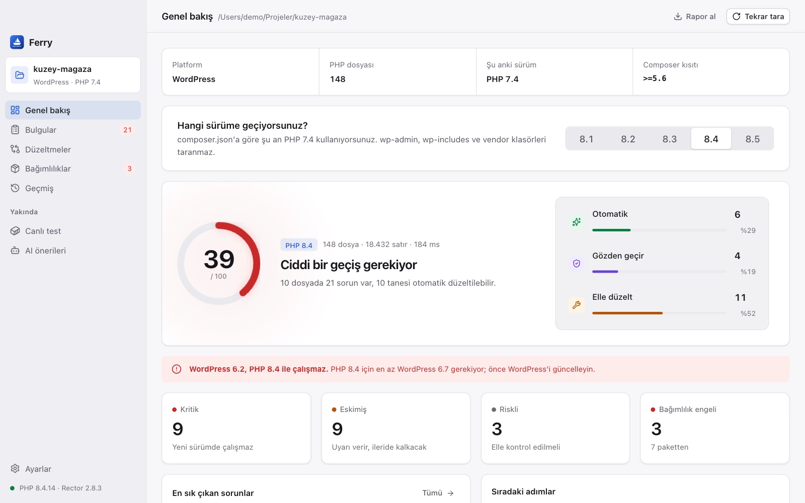

# Ferry

**PHP projenizi yeni sürüme taşırken nelerin bozulacağını önceden görün, güvenle düzeltin.**

Ferry, macOS ve Windows'ta çalışan bir masaüstü uygulamasıdır. PHP kodunuzu tarar, geçmek istediğiniz sürümde nelerin bozulacağını gösterir ve Rector'ın önerdiği düzeltmeleri yalnızca siz onayladıktan sonra uygular. Her değişiklikten önce yedek alır. Hesap açmanız gerekmez; kodunuz bulutta değil, kendi bilgisayarınızda kalır.

[](../../releases/latest)

   [](LICENSE)

[Özellikler](#özellikler) · [Kurulum](#kurulum) · [Gizlilik](#gizlilik) · [Nasıl çalışır](#nasıl-çalışır) · [Kaynaktan derleme](#kaynaktan-derleme) · [English](README.md)



- **Sorunları kullanıcılarınızdan önce görün.** PHP 7.0 ile 8.5 arasında kaldırılan ya da değişen her kullanım; dosyası, satırı ve neden önemli olduğuyla listelenir.
- **Siz onaylamadan hiçbir şey değişmez.** Rector yalnızca deneme modunda çalışır. Her değişikliği satır satır inceler, yalnızca seçtiğiniz dosyaları uygularsınız.
- **Her değişikliği tek tıkla geri alın.** Her uygulamadan önce yedek alınır. Geri dönmek için Git kullanmanız gerekmez.

## Öne çıkan özellikler

- **Önünüzdeki işin büyüklüğünü görün.** 0 ile 100 arasındaki hazırlık puanı ve düzeltmelerin otomatik, gözden geçirilecek ve elle yapılacak olarak dağılımı, geçişin ne kadar süreceğini bir bakışta gösterir.
- **Hangi düzeltmeye güvenebileceğinizi bilin.** Her bulgu ve her değişiklik etiketlidir: **Otomatik** (davranışı değiştirmeyen, kurala dayalı bir dönüşüm), **Gözden geçir** (genellikle doğrudur ama bakmaya değer) ya da **Elle düzelt** (kararı sizin vermeniz gerekir).
- **Yalnızca gerekeni düzeltin ya da kodu modernleştirin.** **Uyumluluk** modu yalnızca kodun yeni sürümde çalışması için gerekenleri değiştirir. **Modernleştirme** ise `match`, constructor promotion ve `str_contains` gibi yeni yazımları da benimser.
- **Sizi geride tutan paketleri bulun.** Ferry `composer.lock` dosyasını okur ve hedef sürümü desteklemeyen paketleri, koda dokunmaya başlamadan önce gösterir.
- **Diske yazılan, önizlemede gördüğünüzün aynısıdır.** Değişiklikleri Ferry, sizin gördüğünüz haliyle kendisi uygular. Önizlemeden sonra değişen bir dosyaya dokunmaz.
- **Taramaya başlamak için kurulum gerekmez.** Tarayıcı Ferry'nin içindedir ve PHP gerektirmez. PHP ve Composer yalnızca otomatik düzeltmeler için gerekir; Rector'ı da Ferry sizin için kurar.

## Özellikler

### Hedef sürümünüz için hazırlık puanı

Geçmek istediğiniz sürümü seçin (PHP 8.1 ile 8.5 arası); Ferry tüm PHP dosyalarını saniyeler içinde tarar. **Genel bakış** ekranında şunları görürsünüz:

- projenin platformu (WordPress, Laravel, Symfony, Drupal ya da düz PHP), PHP dosyası sayısı ve `composer.json`'a göre şu anki PHP sürümü
- 0 ile 100 arasında bir hazırlık puanı ve her düzeltme türüne düşen sorun sayısı
- bulguların kaçının **Kritik** (kod çalışmaz), **Eskimiş** (şimdilik uyarı verir, ileride kaldırılır) ya da **Riskli** (çalışırken farklı davranabilir) olduğu
- en sık görülen sorunlar ve atmanız gereken sonraki adımlar

Bakımını sizin yapmadığınız framework kodu kendiliğinden atlanır: WordPress'te `wp-admin` ve `wp-includes`, Laravel'de `storage` ve `bootstrap/cache`, Symfony'de `var`, Drupal çekirdeği; her projede de `vendor` ve `node_modules`. Atlanan klasörler genel bakışta yazılıdır.

**Rapor al** ile sonuçları bir Markdown dosyasına kaydedebilir, bir iş kaydına ekleyebilir ya da ekibinizle paylaşabilirsiniz.

### Her bulgu, açıklamasıyla

**Bulgular** sayfası her sorunu dosyasına göre gruplar; satırını, kodunu ve düzeltme türünü gösterir. Düzeltme türüne ya da önem derecesine göre süzebilir, dosyalarda ve sorunlarda arama yapabilirsiniz.


Bir bulguyu seçtiğinizde şunları görürsünüz:

- soruna yol açan kod
- neden önemli olduğu ve hangi PHP sürümünden beri geçerli olduğu
- yerine ne kullanmanız gerektiği
- otomatik olarak düzeltilip düzeltilemeyeceği

**Dosyayı göster** dosyanın bulunduğu klasörü açar. Listede ok tuşlarıyla gezinebilirsiniz.

Ferry'nin kendi PHP sözcük çözümleyicisi ve kural seti vardır; kodu PHP'nin okuduğu gibi okur. `$db->each()` gibi metot çağrıları, kendi namespace'inizdeki fonksiyonlar, metinlerin ve yorumların içindekiler kaldırılmış fonksiyon sanılmaz. Kurallar şunları kapsar:

- `mysql_*`, `ereg*`, `each()`, `create_function()` ve `money_format()` gibi kaldırılan eklenti ve fonksiyonlar
- `$str{0}`, `(real)` ve `(unset)` dönüşümleri ve PHP 8'in attribute olarak okuduğu PHP 7 `#[` yorumları gibi artık ayrıştırılamayan yazımlar
- `"${var}"` yerleştirmesi, örtük nullable parametreler, `utf8_encode()`, `FILTER_SANITIZE_STRING` ve `E_STRICT` gibi kullanımdan kalkanlar
- `eval()`, `extract()` ve değişken değişkenler gibi elle kontrol edilmesi gereken kodlar

### Her değişikliği uygulamadan önce inceleyin

**Düzeltmeler** sayfası Rector'ı projenizde deneme modunda çalıştırır; hiçbir dosya değişmez. Değişen her dosyanın farkını satır satır, değişikliği üreten kuralları ve ona ne kadar güvenebileceğinizi görürsünüz.


- **Uyumluluk** yalnızca yeni sürümde çalışmak için gerekenleri değiştirir. Başlamak için en doğru yer burasıdır.
- **Modernleştirme** hedef sürümün yeni yazımlarını da benimser.
- İstediğiniz dosyaları seçip **Uygula**'ya basın. **Gözden geçir** olarak işaretlenen dosyalarda önce kontrol etmeniz için bir not bulunur.

Ferry, Rector'ın tek başına çözemediği durumları da ele alır. Örneğin `$str{0}` yazımı içeren bir dosyayı Rector tamamen atlar. Ferry bu yazımları önce `$str[0]` olarak düzeltir, böylece dosyanın geri kalanı da düzeltilir.

### Geçişi engelleyen bağımlılıklar

**Bağımlılıklar** sayfası, kilitli her paketi `composer.lock`'ta bildirdiği PHP gereksinimine göre hedef sürümle karşılaştırır. Projenin `composer.json`'daki kendi PHP kısıtı da kontrol edilir.


Her paket **Uyumlu**, **Uyumsuz** ya da **Belirsiz** (paket bir PHP gereksinimi bildirmiyorsa) olarak işaretlenir. Geliştirme paketleri etiketlidir; **Sadece üretim** seçeneği onları gizler.

### Her şeyi Geçmiş'ten geri alın

Ferry her uygulamadan önce değiştireceği dosyaları yedekler. **Geçmiş** sayfası her uygulamayı zamanı ve dosya sayısıyla listeler.


- **İncele**, her uygulamanın neyi değiştirdiğini dosya dosya ve her değişikliğin ardındaki kurallarla birlikte gösterir.
- **Geri yükle**, o uygulamadan önceki halleriyle bütün dosyaları geri getirir. Bunlardan birini sonradan düzenlediyseniz Ferry önce o dosyaları listeler.
- Bir uygulama yarıda kalırsa Ferry dosyaları kendiliğinden geri alır. Bu da başarısız olursa yedek Geçmiş'te kalır; oradan kendiniz geri yükleyebilirsiniz.

### Masaüstünüz için tasarlandı

- **Türkçe ve İngilizce** arayüz. Seçtiğiniz dil dışa aktarılan raporlarda da kullanılır.
- **Açık ve koyu** tema ya da sistemin teması.
- Proje klasörünü pencereye **sürükleyip bırakın** ya da başlangıç ekranından son projelerinizi yeniden açın.
- **Klavye kısayolları:** **⌘O** proje açar, **⌘1**–**⌘5** sayfalar arasında geçiş yapar, **⌘,** **Ayarlar**'ı açar. Windows'ta **⌘** yerine **Ctrl** kullanın.

## Desteklenen projeler

| Proje türü | Nasıl tanınır | Kendiliğinden atlananlar |
|---|---|---|
| **WordPress** | `wp-config.php`, `wp-config-sample.php` ya da `wp-includes` klasörü | `wp-admin`, `wp-includes` (çekirdek); temalarınız ve eklentileriniz taranır |
| **Laravel** | `artisan` dosyası ya da `composer.json`'da `laravel/framework` | `storage`, `bootstrap/cache` |
| **Symfony** | `composer.json`'da `symfony/framework-bundle` ya da `bin/console` | `var` |
| **Drupal** | `composer.json`'da `drupal/core` ya da `core/lib/Drupal.php` (`web/`, `docroot/`, `html/` veya `public/` altında da) | Drupal çekirdeği, `sites/default/files` |
| **Düz PHP** | PHP dosyası içeren her klasör | — |

WordPress, Laravel, Drupal ve Symfony projelerinde Ferry framework'ün kendisini de kontrol eder:

- **WordPress:** `wp-includes/version.php`'deki çekirdek sürümü, hedef PHP sürümünü destekleyen en eski WordPress sürümüyle karşılaştırılır (örneğin PHP 8.4 için en az WordPress 6.7 gerekir).
- **Laravel:** `composer.lock`'taki `laravel/framework` sürümü Laravel'in desteklediği PHP aralığıyla karşılaştırılır. Ayrıca Laravel 6'nın kaldırdığı `str_*` ve `array_*` yardımcıları ile `Input` facade'ı işaretlenir; PHP 8 en az Laravel 6.20 gerektirdiği için `laravel/helpers` kurulu değilse bunlar da bozulur.
- **Drupal:** Çekirdek sürümü Drupal'ın PHP gereksinimleriyle karşılaştırılır (örneğin PHP 8.5 için en az Drupal 11.3 gerekir).
- **Symfony:** Symfony en yüksek PHP sürümünü yayımlamadığı için, bakımı hedef PHP sürümü çıkmadan biten bir sürüm **Riskli** olarak işaretlenir.

`vendor` ve `node_modules` her zaman atlanır. 2 MB'tan büyük dosyalar atlanır ve tarama sonuçlarında listelenir; hiçbir dosya sessizce dışarıda kalmaz.

Hedef sürümler: **PHP 8.1, 8.2, 8.3, 8.4 ve 8.5**. Tarama PHP 7.0'dan bu yana yapılan değişiklikleri kapsadığı için PHP 5.6 ve 7.x projeleri de desteklenir.

## Kurulum

[Son sürümden](../../releases/latest) sisteminize uygun dosyayı indirin. Bir proje klasörü açıp **Taramayı başlat**'a basın. Siz bir klasör seçmeden Ferry hiçbir şey okumaz.

### macOS

Apple silicon ve Intel işlemcili Mac'lerde macOS 11 ve üstü.

1. `Ferry_x.y.z_universal.dmg` dosyasını açın ve **Ferry**'yi **Uygulamalar** klasörüne sürükleyin.
2. Ferry'yi **Uygulamalar** klasöründen açın.

> **Gatekeeper.** Ferry henüz bir Apple Developer ID ile imzalanmadığı için macOS ilk açılışta uygulamayı engelleyebilir. **Sistem Ayarları → Gizlilik ve Güvenlik** bölümünü açın ve Ferry ile ilgili mesajın yanındaki **Yine de Aç**'ı seçin.

**Kaldırma.** Uygulamayı Çöp Sepeti'ne sürükleyin. Yedekler ve ayarlar, siz silene kadar `~/Library/Application Support/io.github.efekoca.ferry` klasöründe kalır.

### Windows

Windows 10 ve 11.

1. `Ferry_x.y.z_x64-setup.exe` dosyasını çalıştırın. Kurulum **yalnızca sizin kullanıcınız için** yapılır ve yönetici yetkisi gerektirmez.
2. Windows 11'de WebView2 zaten vardır. Windows 10'da eksikse kurulum sırasında eklenir.

> **SmartScreen.** Kurulum dosyası kod imzalı olmadığı için Windows "Bilinmeyen yayımcı" uyarısı gösterebilir. **Ek bilgi → Yine de çalıştır**'ı seçin.

**Kaldırma.** Windows Ayarları → Uygulamalar bölümünü kullanın. Yedekler ve ayarlar, siz silene kadar `%APPDATA%\io.github.efekoca.ferry` klasöründe kalır.

### Otomatik düzeltmeler

Tarama ve bağımlılık kontrolü hemen çalışır. Otomatik düzeltmeler için ayrıca şunlar gerekir:

- Bilgisayarda **PHP 7.4 ya da üstü** (projenizin kullandığı sürüm olması gerekmez). Ferry, `PATH`'inizdeki PHP'yi bulur; ayrıca macOS'ta Homebrew, Herd ve MAMP'ın, Windows'ta XAMPP, Laragon ve Scoop'un olağan konumlarına da bakar. Kullanılacak PHP'yi **Ayarlar**'dan kendiniz de seçebilirsiniz.
- **Composer.** Ferry onu yalnızca bir kez, Rector'ı kendi klasörüne kurmak için kullanır; projenizin `composer.json` dosyasına hiç dokunulmaz.

Eksik bir şey olduğunda **Düzeltmeler** sayfası neyin eksik olduğunu söyler ve **Rector'ı kur** seçeneğini sunar.

## Gizlilik

> **Kodunuz bilgisayarınızdan çıkmaz.** Ferry yalnızca açtığınız klasördeki dosyaları okur ve değiştirir; hiçbir kullanım verisi toplamaz.

- **Okunanlar:** seçtiğiniz proje klasöründeki PHP dosyaları, `composer.json` ve `composer.lock`.
- **Yazılanlar:** yalnızca değişiklik uyguladığınız dosyalar. Diğer dosyalara dokunulmaz.
- **Saklananlar:** her uygulamadan önceki dosya yedekleri, neyin uygulandığının kaydı, Rector'ın önbelleği ve ayarlarınız. Hepsi uygulamanın veri klasöründe durur: macOS'ta `~/Library/Application Support/io.github.efekoca.ferry`, Windows'ta `%APPDATA%\io.github.efekoca.ferry`.
- **Proje kodu:** Tarama kodunuzu hiçbir zaman çalıştırmaz. Düzeltmeleri hesaplarken Rector proje klasöründe çalışır ve projenin `vendor/autoload.php` dosyasını yükler; bu yüzden Composer'ın `autoload.files` listesindeki dosyalar çalıştırılır. Düzeltmeleri yalnızca güvendiğiniz projeler için hesaplayın.
- **Ağ:** Ferry'nin kendisi hiçbir ağ isteği yapmaz. **Rector'ı kur**'u seçtiğinizde Composer, Rector'ı Packagist'ten indirir.

## Nasıl çalışır

Her şey kendi bilgisayarınızda çalışır:

1. Ferry proje türünü ve şu anki PHP sürümünü bulur, bakımını sizin yapmadığınız klasörleri atlar.
2. Yerleşik tarayıcı her PHP dosyasını ayrıştırır ve şu anki sürümünüzle hedef sürüm arasındaki her sürümün kurallarına göre kontrol eder.
3. Düzeltmeler için Rector projenizde deneme modunda çalışır; dilediğiniz an durdurabilirsiniz. Ferry önerilen farkları bir önizlemeye dönüştürür ve her dosyanın parmak izini saklar.
4. Uyguladığınızda Ferry önce seçilen dosyaları yedekler, sonra hiçbirinin önizlemeden bu yana değişmediğini kontrol eder ve her dosyayı tek adımda yazar. Arada değişen bir dosya reddedilir.
5. Geri yükleme yedeği dosyaların üzerine kopyalar. Geçmiş'teki **İncele** ise uygulanan değişiklikleri gösterir.

## Bilinen sınırlamalar

- **Statik analiz:** Tarama kodu çalıştırmadan okur. Bu yüzden çalışma anındaki değerlere bağlı davranışlar (örneğin adı bir metinden gelen fonksiyon çağrıları) her zaman bulunamaz. Bu tür durumlar mümkün olduğunda **Riskli** olarak işaretlenir. Yalnızca eski sürümlerde çalışan kod atlanır: `if (PHP_VERSION_ID < 80100)` ya da `version_compare(PHP_VERSION, '8.0', '<')` bloklarının içi, sürüm kontrolü yapan bir ternary'nin ya da `&&`'nin hiç çalışmayacak tarafı, `if (PHP_VERSION_ID >= 80000) { return …; }` sonrasındaki kod ve `if (function_exists('mysql_connect'))` gibi bloklar. Kaldırılmış bir adla kendi tanımladığınız fonksiyonlar da raporlanmaz; örneğin bir `each()` polyfill'i ya da Composer ile yüklenen bir `mysql_*` uyumluluk katmanı.
- **Davranış değişiklikleri:** Bazı değişiklikler ancak kod çalışınca ortaya çıkar, bu yüzden hiçbir statik araç bunları bulamaz. Uygulamanızı yeni sürümde çalıştırarak test edin:
  - `0 == "foo"` artık `false` döner; bu `in_array()`, `array_search()` ve `switch`'i de etkiler.
  - Sayı olmayan metinlerle yapılan aritmetik işlemler `TypeError` fırlatır.
  - Birçok uyarı exception'a dönüştü; örneğin sayılamayan bir değere `count()`.
  - curl, GD ve XML gibi resource'lar artık nesne, bu yüzden `is_resource()` kontrolleri bozulur.
  - PDO MySQL ve SQLite artık gerçek sayı döndürür, bu yüzden `=== "1"` karşılaştırmaları bozulur.
  - Yerleşik fonksiyonlara değişken üzerinden `null` vermek kullanımdan kalktı.
  - Dinamik property'ler kullanımdan kalktı. Ferry projenizdeki üst sınıfları ve trait'leri izler; ancak `vendor/` içindeki bir framework sınıfı gibi göremediği bir sınıftan türeyenleri atlar, çünkü property orada tanımlanmış olabilir.
  - `ArrayAccess`, `Iterator` ve benzeri arayüzlerin metotlarında `#[\ReturnTypeWillChange]` eksikse uyarı verilir.
  - imap ya da mcrypt gibi gerekli eklentiler yeni sunucuda kurulu olmayabilir.
- **Metot çağrıları:** Ferry kodu çalıştırmadan bir nesnenin sınıfını bilemez. Bu yüzden `$db->ping()` gibi bir metot çağrısı yalnızca aynı dosyada sınıfın adı geçiyorsa (`mysqli`, `Reflection…`, `SplObjectStorage`) işaretlenir. Statik çağrılar ve `PDO::MYSQL_ATTR_INIT_COMMAND` gibi sınıf sabitleri her zaman kontrol edilir.
- **Karakter kodlaması:** Otomatik düzeltmeler UTF-8 olmayan dosyaları (örneğin Windows-1254 ya da Latin-1) bozulmasın diye atlar. Düzeltilmeleri için önce UTF-8'e dönüştürün.
- **Elle yapılan düzeltmeler:** `mysql_*` gibi bulgular kodun yeniden yazılmasını gerektirir. Ferry yerine ne kullanmanız gerektiğini gösterir ama bu kodu sizin yerinize yazmaz.
- **Geri yükleme:** Dosyaları uygulamadan önceki hallerine getirdiği için sonradan yaptığınız düzenlemelerin üzerine yazılır. Ferry bu dosyaları listeler ve geri yüklemeden önce size sorar.
- **Linux:** Henüz desteklenmiyor.

## Kaynaktan derleme

Gereksinimler: Rust (stable), Node 22 ve pnpm; Rector testleri için ayrıca PHP 7.4+ ve Composer. Windows'ta Visual Studio Build Tools (C++), macOS'ta Xcode Command Line Tools da gerekir.

```bash
pnpm install
pnpm tauri dev            # masaüstü uygulaması
pnpm dev                  # yalnızca arayüz, tarayıcıda örnek verilerle
pnpm typecheck && pnpm test
cargo test --workspace
pnpm tauri build          # kurulum dosyaları → target/release/bundle/
```

Testleri gerçek Rector'la çalıştırmak için `FERRY_TEST_TOOLS` değişkenini Rector'ın kurulu olduğu klasöre yönlendirin: `FERRY_TEST_TOOLS=/yol/tools cargo test --workspace`.

**Demo projeleri.** `demo/` klasöründe üç örnek proje var: her kuralı tetikleyen düz PHP bir mağaza, WordPress bir blog ve neredeyse hazır bir Laravel API'si. `pnpm demo` bunları `.demo/` klasörüne sıfırdan kopyalar; böylece asıllarına dokunmadan değişiklik uygulayabilirsiniz. Ayrıntılar için [demo/README.md](demo/README.md).

| Klasör | İçerik |
|---|---|
| `crates/ferry-core` | Motor: sözcük çözümleyici, kurallar ve analiz, Rector entegrasyonu, farklar, yedekler ve Composer kontrolleri |
| `src-tauri` | Masaüstü kabuğu: komutlar, pencere ve platform ayarları |
| `src` | React ve TypeScript arayüzü (tasarım sistemi: [docs/DESIGN.md](docs/DESIGN.md)) |
| `demo` | Uygulamayı denemek ve testler için örnek projeler |

CI, her push'ta Linux'ta arayüz ve motor testlerini (gerçek Rector dahil) çalıştırır; `main` dalına yapılan push'larda Windows'u da ekler, `v*` etiketlerinde macOS ve Windows kurulum dosyalarını oluşturur.

Hata bildirimlerinizi, pull request'lerinizi ve geri bildirimlerinizi almaktan mutluluk duyarım.

## Lisans

[MIT](LICENSE)
